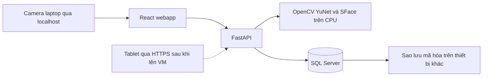

# Kế hoạch triển khai webapp chấm công nhận diện khuôn mặt local

**Phiên bản:** 1.4  
**Ngày tạo:** 28/10/2026 · **Cập nhật:** 29/10/2026  
**Trạng thái:** Goal đang hoạt động; hoàn thiện bản thử đầy đủ bằng một người trên laptop.

Đây là tài liệu kế hoạch và sổ tiến độ duy nhất của dự án. Codex thực hiện toàn bộ công việc kỹ thuật: viết mã, cấu hình, kiểm thử, sửa lỗi, đóng gói và cập nhật file này sau mỗi phiên làm việc. Không phân công nhân sự khác và không có bước ký duyệt hay chờ phê duyệt. Codex chỉ hỏi bạn khi thiếu thông tin nghiệp vụ, cần lựa chọn có ảnh hưởng đáng kể hoặc cần thao tác vật lý trên thiết bị thực tế.

## Quyết định đã chốt

- Xây webapp chấm công cho 100 người/ngày, truy cập bằng iPad và tablet Android.
- Phát hiện khuôn mặt, căn chỉnh, tính vector và so khớp đều chạy trên máy chủ local.
- Dùng thư viện và model miễn phí có giấy phép phù hợp; không có phí API nhận diện định kỳ.
- Không Docker; triển khai bằng môi trường Python riêng và tiến trình/dịch vụ nền native. Bản laptop dùng HTTP localhost; HTTPS và reverse proxy bổ sung khi lên VM, không bắt buộc Caddy.
- Dữ liệu ảnh và vector không gửi ra cloud. Không có phụ thuộc Internet trong luồng vận hành.
- Ưu tiên cải thiện giải pháp miễn phí local nếu chất lượng chưa đạt. Chỉ xem xét API trả phí khi có bằng chứng so sánh và sau khi trao đổi với bạn; không tự tích hợp hoặc bật dịch vụ trả phí.
- Database hiện tại dùng SQL Server có sẵn trên laptop. PostgreSQL để sau, không nằm trong luồng khởi động.
- Các trạng thái, checklist và bằng chứng được cập nhật trực tiếp trong file Markdown này.
- Mỗi ảnh thu mẫu phải có chỉ dẫn rõ hướng mặt trước khi chụp và kết quả Đạt/Chưa đạt sau khi chụp, kèm cách điều chỉnh; ảnh chưa đạt không tăng số mẫu.
- Thu mẫu dùng khung oval và khuôn mặt minh họa chuyển động. Camera tự rà soát, tự chụp khi đúng khung/tư thế và ổn định; có tạm dừng và chụp thủ công dự phòng.
- Giao diện chấm công tham khảo thiết bị BiFace từ 3 ảnh người dùng gửi ngày 29/10: đồng hồ/lời chào bên trái, camera toàn cảnh lớn ở giữa, lượt vừa ghi nhận bên phải và dải kết quả phía dưới. Giữ tự nhận diện/ghi công; không có oval hoặc nút chụp mỗi lượt. Danh sách chỉ từ biên nhận máy chủ đã xác nhận, không dùng dữ liệu minh họa làm kết quả thật; không thêm API thời tiết hoặc tài nguyên ngoài.

“Miễn phí” ở đây là không có chi phí giấy phép bắt buộc cho ứng dụng/model đã chọn hoặc phí API. Thiết bị, điện và thời gian vận hành vẫn có chi phí. Đường Windows sử dụng bản quyền hệ điều hành đã có; Ubuntu là lựa chọn hệ điều hành miễn phí.

## Phạm vi thực hiện hiện tại — quyết định mới nhất của người dùng

**Hoàn thiện toàn bộ chức năng bằng một người, mã 000083. Không chờ thêm người để tiếp tục.** Quyết định này thay thế các yêu cầu về số người/thiết bị và các phụ thuộc nghiệm thu quy mô lớn trong bản kế hoạch cũ.

- Luồng cần hoàn thành: hồ sơ → mẫu tham chiếu → camera toàn cảnh tự bắt mặt → nhận diện ổn định → tự ghi Vào/Ra bằng giờ máy chủ → hiện tên → đọc “Hợp lệ” sau khi lưu → tra cứu, tính và xuất bảng công.
- Dùng ảnh tham chiếu và ảnh camera mới khác lần chụp của người đang có. Một ảnh tham chiếu đủ để kiểm tra luồng; nhiều ảnh là tùy chọn cải thiện sau.
- Cấu hình thử có phạm vi riêng `functional_trial`, chỉ một hồ sơ. Tự ghi công thử không cần quản trị xác nhận mỗi lượt. Kết quả được gắn nhãn thử; không gọi đó là nghiệm thu độ chính xác 100 người hoặc chống ảnh giả.
- T11, T37, T38, T39 và các phép đo nhóm/thiết bị chưa có được chuyển sang **Ghi chú thử mở rộng sau**, không phải điều kiện hoàn thành bản thử hiện tại. Công việc chức năng, kiểm thử phần mềm, đóng gói và hướng dẫn vẫn tiếp tục.
- Hoàn thành checklist hiện tại khi có bằng chứng chức năng trên laptop; không yêu cầu đủ nhóm, đủ 100 người, tablet thật hoặc chờ 10 ngày chạy thực tế. Những việc đó nằm trong ghi chú sau.

## Tiến độ hiện tại

| Nội dung | Trạng thái |
|---|---|
| Kế hoạch và tiêu chí kiểm tra | Đã soạn |
| Đầu việc triển khai hoàn tất | **34/38** trong phạm vi hiện tại; 4 việc đo mở rộng chuyển ghi chú |
| Kiểm thử đạt có minh chứng | **20/27** trong phạm vi hiện tại; 5 ca mở rộng chuyển ghi chú |
| Mốc đang thực hiện | **M5** — bản native đã đóng gói/kiểm tra offline; tiếp tục vận hành. **M6** — hồi quy đạt, hướng dẫn và chốt bản thử tiếp tục sau M5. |
| Đầu việc đang làm | M5: T30/T31 còn kiểm chứng thực tế; T34 đang đo lại độ trễ. T36 đạt, hướng dẫn T41 đã hoàn thiện; T42 tiếp tục chốt bản và các kiểm thử còn mở. |
| Điểm cần thao tác thực tế | Chưa reboot để chốt KT27. USB E:\Database\ChamCong đã có backup, sổ dấu xóa và khóa có mật khẩu do người dùng tự lưu; kiểm chứng đạt. Không chờ nhóm người mới. |
| Bước tiếp theo | Kiểm tra toàn luồng khi chặn mạng ngoài, tải kỹ thuật/CPU backup và nâng cấp/quay lui; hoàn thiện T41/T42. |

Các mục chưa đánh dấu dưới đây là việc phải làm, không phải các chức năng đã có. Các con số độ chính xác, độ trễ và khôi phục trong tài liệu là mục tiêu kiểm thử, chưa phải kết quả đã đo.

## Cách cập nhật tiến độ

1. Trước một phiên triển khai, chọn việc theo phụ thuộc và cập nhật “Đầu việc đang làm”.
2. Sau khi viết mã, chạy kiểm thử phù hợp. Ghi bằng chứng tại đúng mã Txx hoặc KTxx: commit, đường dẫn log, báo cáo benchmark hay ảnh giao diện; tránh chép dữ liệu khuôn mặt thật vào tài liệu.
3. Chỉ đổi `[ ]` thành `[x]` khi tiêu chí xong đã đạt, đã kiểm thử chức năng liên quan. Tích hợp thực tế một người ghi tại T23; phép đo mở rộng không chặn nghiệm thu phần mềm khác.
4. Nếu đang làm hoặc bị chặn, giữ `[ ]` và ghi ngắn trạng thái/nguyên nhân dưới mục đó. Không đánh dấu hoàn tất chỉ vì đã viết mã.
5. Cập nhật số lượng hoàn tất ở bảng tổng quan, trạng thái các mốc và nhật ký cuối file. Tỷ lệ theo số việc phản ánh phạm vi hoàn thành, không phản ánh chính xác thời gian/công sức.
6. Nếu cần bổ sung phạm vi, thêm mã mới và cập nhật tổng số; giữ các mã cũ ổn định để truy vết. Lỗi phát hiện sau khi đánh dấu xong phải mở lại mục liên quan.

## Mục lục

- [Phạm vi và các giả định](#01-phạm-vi-và-các-giả-định-triển-khai)
- [Kiến trúc và công nghệ](#02-kiến-trúc-ứng-dụng-và-công-nghệ)
- [Chức năng của webapp](#03-chức-năng-của-webapp)
- [Luồng trên tablet](#04-luồng-đăng-ký-và-sử-dụng-trên-tablet)
- [Quy tắc chấm công](#05-quy-tắc-chấm-công-và-bảng-công)
- [Thiết kế nhận diện](#06-thiết-kế-nhận-diện-hoàn-toàn-local)
- [Dữ liệu và API](#07-dữ-liệu-và-hợp-đồng-api-nội-bộ)
- [Bảo vệ dữ liệu và ngoại tuyến](#08-bảo-vệ-dữ-liệu-và-vận-hành-ngoại-tuyến)
- [Các mốc và checklist triển khai](#09-các-mốc-xây-dựng-và-checklist-triển-khai)
- [Triển khai Windows](#10-trình-tự-triển-khai-trên-windows)
- [HTTPS khi lên VM](#11-https-ở-giai-đoạn-máy-chủ-ảo)
- [Đo nhận diện và hiệu năng](#12-kế-hoạch-kiểm-thử-nhận-diện-và-hiệu-năng)
- [Checklist kiểm thử và nghiệm thu](#13-checklist-kiểm-thử-và-nghiệm-thu)
- [Sao lưu và xử lý sự cố](#14-sao-lưu-nâng-cấp-và-xử-lý-sự-cố)
- [Bước bắt đầu và giới hạn](#15-việc-đầu-tiên-và-các-giới-hạn-cần-theo-dõi)
- [Nguồn kỹ thuật](#16-tài-liệu-kỹ-thuật-tham-chiếu)
- [Nhật ký triển khai](#17-nhật-ký-triển-khai)

## 01 Phạm vi và các giả định triển khai

Bản đầu phục vụ một địa điểm, tối đa 100 hồ sơ nhân viên đang hoạt động và hai kiosk tablet. Giả định 2–4 lượt chấm mỗi người mỗi ngày, cao điểm 100 người trong 10 phút. Đây là phạm vi thiết kế để đo kiểm; thay đổi số hồ sơ hoặc số kiosk phải đánh giá lại.

### Nằm trong bản đầu

- Quản trị nhân viên, đăng ký nhiều mẫu khuôn mặt, ngừng hoạt động và xóa dữ liệu sinh trắc theo chính sách.
- Kiosk nhận diện tự động, ghi nhận vào/ra, chống ghi trùng và thông báo khi không đủ điều kiện.
- Ca ngày và ca qua đêm, lịch làm việc, bảng công, ngoại lệ thiếu lượt, điều chỉnh và xuất dữ liệu.
- Đăng nhập quản trị, quản lý thiết bị, nhật ký thay đổi, sao lưu, khôi phục và tự khởi động dịch vụ.

### Chưa đưa vào bản đầu

Tính lương và thuế, mở cửa, nhiều chi nhánh, nhận diện từ camera giám sát, nhận diện qua khẩu trang kín, chấm công ngoài mạng nội bộ và tự đồng bộ ảnh chờ khi mất LAN. Những mục này chỉ bổ sung khi có nhu cầu cụ thể.

### Nền tảng máy chủ

Người dùng xác nhận chạy tạm trên laptop Windows 11 Pro hiện tại, đã có camera, sau đó chuyển lên máy chủ ảo. Cấu hình và đường dẫn phải độc lập máy. Đường triển khai Windows tận dụng bản quyền hệ điều hành sẵn có; hệ điều hành này không phải phần mềm miễn phí. Nếu máy chủ khác hoặc cần hệ điều hành miễn phí hoàn toàn, dùng Ubuntu Server LTS và chạy cùng mã ứng dụng bằng systemd. Việc này được xác định ở T01, trước khi cài đặt.

### Thông tin nghiệp vụ có thể điều chỉnh


| Thông tin | Mặc định để bắt đầu |
| --- | --- |
| Ca và cách ghi vào ra | Có cấu hình, không ghi cứng. Mỗi kiosk có chế độ Vào, Ra hoặc cho chọn rõ trước khi quét. |
| Chống gian lận | Thử ảnh/video ngay M1. Chỉ vận hành tự động không giám sát khi vượt bộ thử đã định. |
| Giữ dữ liệu | Ảnh quét không lưu mặc định; thời hạn hồ sơ, audit và backup là cấu hình cần thống nhất. |
| Thiết bị và mạng | Một máy chủ CPU, tối đa hai tablet; địa chỉ LAN ổn định, HTTPS tin cậy. |

Không gán lịch hoàn tất cố định trước khi thử camera và AI. Các mốc M0–M6 là thứ tự thực hiện; thời lượng thực tế được cập nhật từ kết quả triển khai. Chạy thử đủ 100 người có cửa sổ quan sát 10 ngày làm việc.

## 02 Kiến trúc ứng dụng và công nghệ




Một backend dạng khối thống nhất phục vụ nghiệp vụ và gọi trực tiếp thư viện AI. Không cần microservice, cloud, cơ sở dữ liệu vector hay GPU ở bản đầu. API ở đây là API nội bộ do ứng dụng tự cung cấp.


| Thành phần | Lựa chọn và trách nhiệm |
| --- | --- |
| Webapp | TypeScript và React; giao diện tiếng Việt responsive, trang kiosk và quản trị; build tài nguyên tĩnh local. |
| Backend | Python 3.12 làm baseline, FastAPI, Uvicorn; cấu hình qua tệp môi trường và migration có phiên bản. |
| AI | OpenCV với YuNet và SFace dạng ONNX; chọn cặp model/runtime tương thích và khóa phiên bản sau M1. |
| Dữ liệu | SQL Server qua SQLAlchemy/pyodbc, ODBC Driver 18; laptop dùng Windows Authentication. Vector được so khớp trong bộ nhớ và cập nhật cache khi hồ sơ đổi. |
| HTTPS | Chưa cần ở laptop localhost. Khi lên VM, dùng SSL/HTTPS của hạ tầng được chọn; reverse proxy không cố định công nghệ. |
| Dịch vụ nền | Laptop chạy backend/frontend/SQL Server native. Khi lên máy chủ dùng Task Scheduler/Windows Service hoặc systemd tùy OS. |

### Tài nguyên và khả năng phục hồi

Cấu hình khởi điểm để thử: CPU x86-64 ít nhất 4 nhân tương đối mới, RAM 16 GB, SSD còn trống tối thiểu 50 GB. Máy chủ nối Ethernet, tablet dùng Wi-Fi ổn định. Chưa mua GPU trước khi benchmark. Dùng UPS nếu cần duy trì khi mất điện ngắn.

Backend nạp model lúc khởi động và chỉ báo sẵn sàng sau warmup. Giới hạn số suy luận đồng thời và chiều dài hàng đợi. Đối tượng model dùng chung phải được khóa hoặc tách theo worker, không giả định thread-safe. Kiểm thử hai kiosk sẽ quyết định cấu hình cuối.


### Edition SQL Server và phạm vi miễn phí

Laptop có SQL Server 2025 Enterprise Developer 17.0.1000.7 và ODBC Driver 18. Dùng edition này để xây dựng/kiểm thử; không coi đó là giấy phép vận hành thực tế. SQL Server Express là lựa chọn miễn phí khi đưa hệ thống vào sử dụng, hoặc dùng máy chủ đã có giấy phép hợp lệ. Không sử dụng tính năng chỉ có ở Enterprise cho nghiệp vụ ứng dụng. Nguồn: [Microsoft SQL Server editions](https://learn.microsoft.com/en-us/sql/sql-server/editions-and-components-of-sql-server-2025?view=sql-server-ver17).

## 03 Chức năng của webapp


| Mã | Chức năng | Điều kiện hoàn thành |
| --- | --- | --- |
| F01 | Kiosk chấm công | Mở camera, hướng dẫn căn mặt, nhận diện tự động và trả kết quả sau khi lưu. |
| F02 | Hồ sơ nhân viên | Mã duy nhất, họ tên, đơn vị, trạng thái; tìm kiếm và nhập danh sách có kiểm tra lỗi. |
| F03 | Đăng ký khuôn mặt | Hỗ trợ nhập 1 ảnh đạt/người; thu camera có hướng dẫn 5–10 mẫu là lựa chọn bổ sung. Tạo vector và cảnh báo nghi trùng người khác. Số ảnh vận hành chốt sau thử độc lập. |
| F04 | Quản lý kiosk | Định danh thiết bị, chế độ Vào/Ra, cấp phiên, thu hồi và xem lần hoạt động gần nhất. |
| F05 | Ca và lịch làm việc | Ca thường/qua đêm, khoảng nghỉ, cửa sổ nhận ca, phân lịch theo ngày. |
| F06 | Bảng công | Hiển thị sự kiện gốc, phút công, đi muộn, về sớm, thiếu lượt và ngoại lệ. |
| F07 | Điều chỉnh công | Thêm điều chỉnh có lý do, lưu trước/sau; khóa và mở lại kỳ có audit. |
| F08 | Báo cáo | Lọc theo người/đơn vị/ngày/tháng; xuất CSV hoặc XLSX không phụ thuộc dịch vụ ngoài. |
| F09 | Cấu hình | Chính sách ca, ngưỡng AI đã hiệu chỉnh, chống trùng, lưu dữ liệu và bản model hiện hành. |
| F10 | Vận hành | Sức khỏe dịch vụ, bản sao lưu, dung lượng, lỗi gần đây và hướng dẫn khôi phục. |

### Quyền sử dụng trong ứng dụng

Bản đầu chỉ cần tài khoản quản trị của bạn và quyền kiosk giới hạn trên các tablet. Đây là quyền phần mềm, không phải phân công nhân sự triển khai. Kiosk chỉ được mở phiên nhận diện và xem kết quả phiên của nó; không được tải danh sách ảnh/vector, sửa công hoặc thay cấu hình.

Không cần tài khoản riêng cho từng nhân viên trong bản đầu. Có thể thêm trang tự xem công sau nếu cần. Không thêm phân tích tuổi, giới tính, cảm xúc hoặc các thuộc tính không phục vụ chấm công.

### Trạng thái khi có lỗi

Giao diện phân biệt rõ chưa nhận diện, không đủ chất lượng, không khớp, nghi giả mạo, thiết bị hết quyền và máy chủ không sẵn sàng. Chỉ hiển thị “Đã chấm công” khi backend đã commit sự kiện; không dùng một thông báo thành công chung cho mọi bước.

## 04 Luồng đăng ký và sử dụng trên tablet

### Đăng ký một nhân viên

1. Tạo hồ sơ bằng mã nhân viên duy nhất và kiểm tra thông tin.
2. Mở camera ở trang quản trị; chụp nhiều ảnh chính diện và hơi lệch, có/không kính thường dùng. Ảnh phải thuộc đúng người được đăng ký.
3. Server kiểm tra một khuôn mặt, độ nét, sáng, kích thước và tư thế; phản hồi lý do nếu cần chụp lại.
4. Tạo vector bằng model hiện hành, kiểm tra nghi trùng hồ sơ khác và lưu mẫu hợp lệ trong một giao dịch.
5. Thử quét bằng ảnh mới, xác nhận hệ thống trả đúng mã nhân viên trước khi sử dụng hồ sơ.

### Một lượt chấm công

Kiosk chuyển theo chuỗi: chờ người → căn mặt → chụp chuỗi ảnh → kiểm tra chất lượng và phiên → so khớp → lưu sự kiện → thông báo → chờ người rời khung. Chế độ Vào/Ra hiển thị rõ, không suy luận chỉ bằng cách đảo trạng thái sau mỗi lần quét.

Khi cần thử thách chuyển động, server phát challenge ngẫu nhiên có thời hạn và kiểm tra chuỗi ảnh ở server. Quay đầu/nháy mắt đơn giản chỉ là biện pháp giảm một số giả mạo; phải thử video và ảnh màn hình. Không gắn nhãn “chống giả mạo hoàn toàn”.

### Quy tắc giao diện

- Nút lớn, chữ dễ đọc, tương phản rõ; dùng được dọc/ngang. Hiển thị tên và thời điểm ngắn rồi tự xóa kết quả khỏi màn hình.
- Chỉ gửi chuỗi ảnh cần cho một phiên, không stream liên tục camera lên backend. Giới hạn tần suất, kích thước và số ảnh tại cả client lẫn server.
- Cần cấp quyền camera lần đầu. Webapp phải ở foreground; không hứa camera chạy nền hoặc tự vượt màn hình khóa.
- Có nút khởi động lại camera và hướng dẫn khi quyền bị từ chối. Hỗ trợ mở từ trình duyệt trước; PWA thêm vào màn hình chính là tiện ích.
- Khi mất LAN, báo chưa ghi nhận và dùng bảng ghi tạm để nhập điều chỉnh sau; bản đầu không lưu ảnh chờ trên tablet.

Đặt tablet cố định, ánh sáng phía trước, tránh cửa sổ phía sau. Đo khoảng cách thực tế để mặt đủ lớn trong khung; không chọn thiết bị chỉ dựa trên số megapixel.

## 05 Quy tắc chấm công và bảng công

Sự kiện quét gốc là dữ liệu bất biến. Bảng công được tính từ các sự kiện, lịch ca và điều chỉnh có lịch sử. Mọi thay đổi quy tắc phải có phiên bản để giải thích được vì sao một bảng công có kết quả hiện tại.


| Tình huống | Quy tắc của bản đầu |
| --- | --- |
| Vào và ra | Kiosk có chế độ rõ hoặc người dùng chọn trước khi quét. Không tự đảo Vào/Ra theo lần quét gần nhất. |
| Ghi trùng | Server dùng request ID và transaction. Cooldown khởi điểm 60 giây cho cùng người và cùng chiều, cho phép hiệu chỉnh. |
| Ca đêm | Ca thuộc ngày bắt đầu ca. Ví dụ vào 22 giờ ngày 31 và ra 6 giờ ngày 1 vẫn thuộc ca ngày 31. |
| Nhiều ca hoặc cửa sổ chồng | Dùng lịch phân ca; trường hợp không xác định duy nhất thì gắn ngoại lệ, không âm thầm chọn ca. |
| Thiếu lượt | Gắn thiếu vào/thiếu ra, không tự tính đủ công. Cho bổ sung bằng điều chỉnh có lý do. |
| Giờ và làm tròn | Lưu thời điểm UTC từ server, hiển thị Asia/Ho_Chi_Minh. Tính phút thực, làm tròn theo cấu hình riêng nếu có. |
| Khoảng nghỉ | Cấu hình nghỉ có/không tính công; không trừ mặc định khi chưa có quy tắc. |
| Ngoài ca và dung sai | Bản đầu chỉ tự cộng thời gian trong ca; ngoài ca báo riêng, chưa tự tính tăng ca. Dung sai chỉ phân loại muộn/sớm, không bù thêm phút thực. |
| Sửa công và khóa kỳ | Quản trị có thể sửa nghiệp vụ có lý do. Kỳ khóa phải mở lại có audit trước khi tính lại. |

### Bộ ví dụ phải viết thành kiểm thử

Ca 08:00–17:00, nghỉ không tính công 12:00–13:00: đủ lượt cho kết quả 480 phút. Vào 08:07, ra 17:00 cho 473 phút nếu chưa áp dụng dung sai/làm tròn. Ca 22:00–06:00 không nghỉ cho 480 phút. Đây là dữ liệu kiểm thử, không mặc định lịch làm việc của đơn vị.

Kiểm thử thêm cuối tháng/năm, quét lặp, quét sai chiều, nghỉ phép/ngày không có lịch, đổi lịch trước/sau khi khóa kỳ và điều chỉnh ảnh hưởng nhiều báo cáo. Số phút công trên màn hình và tệp xuất phải được tính từ cùng một dịch vụ nghiệp vụ.

Tài khoản quản trị có thể thực hiện điều chỉnh trực tiếp; bản đầu không xây thêm luồng duyệt nhiều cấp.

## 06 Thiết kế nhận diện hoàn toàn local

YuNet tìm vị trí khuôn mặt và điểm mốc. OpenCV căn chỉnh ảnh. SFace tạo vector đặc trưng. Backend chuẩn hóa vector theo yêu cầu model và so độ tương đồng với các mẫu của từng nhân viên. Toàn bộ bước này chạy trên máy chủ. Không huấn luyện lại model khi thêm nhân viên. [S01–S03]

### Cách ra quyết định

- Lọc hồ sơ đang hoạt động và vector cùng phiên bản model. So khớp với các mẫu đã lưu, tổng hợp điểm theo từng người bằng một quy tắc cố định được kiểm thử.
- Lấy hai ứng viên thuộc hai người khác nhau. Chỉ chấp nhận khi điểm tốt nhất vượt ngưỡng và cách ứng viên thứ hai đủ xa.
- Yêu cầu kết quả nhất quán trong các khung hình đạt chất lượng. Số khung và ngưỡng do M1 hiệu chỉnh, không chép nguyên ngưỡng demo vào production.
- Khi ảnh không đủ chất lượng, điểm sát ngưỡng hoặc nghi giả mạo, trả trạng thái thử lại; không ép chọn người có điểm cao nhất.

### Dữ liệu và hiệu chỉnh

Tách ảnh đăng ký, tập hiệu chỉnh và tập đánh giá cuối theo phiên chụp/ngày. Tập đánh giá phải bao gồm khác ánh sáng, kính, khoảng cách và người ngoài danh sách. Sau khi chọn ngưỡng bằng tập hiệu chỉnh, khóa cấu hình trước khi đo tập cuối. Nếu sửa ngưỡng theo lỗi tập cuối thì cần một tập đánh giá mới.

**Điều chỉnh T07 theo yêu cầu ngày 28/10/2026:** bộ khởi đầu là ít nhất 10 người, mỗi người 1 ảnh tham chiếu đạt và vector hợp lệ. Bộ này đủ xây dựng/tích hợp/kiểm tra luồng, chưa đủ chứng minh độ chính xác hoặc bật ghi công thật. Việc bổ sung ảnh hiệu chỉnh độc lập/người ngoài thuộc tiêu chí nghiệm thu T09/T10; tập cuối và quy mô vận hành vẫn thuộc T39/KT06/KT07. Không xóa hoặc nới các tiêu chí chất lượng cuối dự án. Các phụ thuộc là điều kiện nghiệm thu; công việc lập trình, UI, kiểm thử dữ liệu giả có thể tiến hành song song trước khi đủ dữ liệu thực.

Lưu model_id, checksum, kích thước vector, cách căn chỉnh và phiên bản quy tắc so khớp. Đổi model cần tạo lại vector bằng ảnh đăng ký còn hợp lệ hoặc đăng ký lại. Không so trực tiếp vector từ hai model khác nhau.

### Giới hạn và hướng cải thiện

Model nhận diện không tự là model chống giả mạo. M1 phải thử ảnh in, ảnh hiển thị trên điện thoại và video. Nếu chưa đạt, ưu tiên cải thiện thu ảnh, thử thách và model PAD local có giấy phép phù hợp. Chế độ có giám sát được dùng trong thời gian xử lý; không tự hạ tiêu chí để tuyên bố đạt.

Chỉ đề xuất dịch vụ trả phí sau khi có số liệu chứng minh các giải pháp local phù hợp không đạt và thử đối chứng cho thấy lợi ích rõ. Việc gọi API trả phí không thuộc phạm vi triển khai đã chốt.

## 07 Dữ liệu và hợp đồng API nội bộ


| Nhóm dữ liệu | Trường và ràng buộc chính |
| --- | --- |
| employees | ID nội bộ, mã nhân viên duy nhất, tên, đơn vị, trạng thái, thời điểm thay đổi. |
| face_templates | employee_id, model_id, vector, chất lượng, thời điểm thu và trạng thái; không trả qua API kiosk. |
| devices và sessions | Kiosk, quyền, chiều Vào/Ra, token/phiên có hạn, challenge và trạng thái thu hồi. |
| attendance_events | ID, employee_id, device_id, server_time, chiều, request_id duy nhất, model/threshold version và kết quả. |
| shifts và assignments | Ca, khoảng nghỉ, cửa sổ chấm và lịch từng nhân viên theo ngày. |
| adjustments và timesheets | Điều chỉnh có lý do; kết quả tính theo kỳ và phiên bản, trạng thái khóa. |
| audit_logs | Thao tác quản trị, đối tượng, trước/sau phù hợp, thời gian; không chứa mật khẩu, ảnh hoặc vector. |

### API dự kiến


```text
POST /api/auth/login
POST /api/employees/{id}/enroll
POST /api/kiosk/sessions
POST /api/kiosk/sessions/{id}/recognize
GET  /api/kiosk/requests/{request_id}
GET  /api/attendance/events
POST /api/attendance/adjustments
GET  /api/reports/attendance
GET  /health/live    GET /health/ready
```

Kiosk chỉ gửi ảnh, session/request ID và thông tin cần cho phiên. Không tin employee_id, điểm nhận diện hoặc giờ chấm do client tự khai. Server xác định danh tính, chiều hợp lệ theo quyền kiosk và thời điểm ghi nhận.

Kết quả có status, request_id, event_id khi đã lưu, mã nhân viên và thời gian cần hiển thị. Dùng mã trạng thái nghiệp vụ rõ như no_face, low_quality, unknown, ambiguous, spoof_suspected, duplicate và recorded. Nếu response thất lạc sau commit, client tra request ID để lấy lại kết quả.

DB là nguồn dữ liệu chính. Cập nhật mẫu khuôn mặt phải làm mới cache nhận diện; lưu đồng nhất phiên bản cache để tránh nhận hồ sơ đã ngừng hoạt động.

## 08 Bảo vệ dữ liệu và vận hành ngoại tuyến

### Phạm vi mạng

Cho phép kiosk truy cập HTTPS tới máy chủ. Backend bind loopback, SQL Server chỉ mở local nếu cùng máy. Cổng quản trị hệ điều hành giới hạn cho máy quản trị. Tải thư viện/model ở giai đoạn chuẩn bị, lưu bản khóa và bộ cài để phục hồi không cần Internet.

Frontend không dùng font, script hoặc analytics từ CDN. Service worker nếu có chỉ cache tài nguyên giao diện tĩnh; không cache ảnh, vector hoặc response quản trị. Kiểm tra bằng cách chặn WAN rồi khởi động lại cả máy chủ và tablet.

### Truy cập và lưu trữ

- Mật khẩu quản trị băm bằng thuật toán phù hợp như Argon2; phiên HttpOnly/Secure và SameSite, CSRF cho thao tác thay đổi, giới hạn đăng nhập sai.
- Kiosk có quyền riêng và có thể thu hồi. Mỗi phiên nhận diện có thời hạn, ràng buộc thiết bị và chống phát lại; TLS không thay thế kiểm tra giả mạo khuôn mặt.
- Giới hạn kích thước upload, độ phân giải ảnh, số khung/phiên và tốc độ yêu cầu; không để ảnh hỏng chiếm hết RAM/CPU.
- Ảnh quét chỉ xử lý trong bộ nhớ theo mặc định. Nếu cần lưu mẫu lỗi để cải thiện, bật có mục đích, thời hạn ngắn và xóa theo cấu hình.
- Mã hóa ổ hoặc vùng dữ liệu và bản sao lưu; khóa giải mã lưu riêng theo cách có thể phục hồi. Vector là dữ liệu sinh trắc, không được coi là dữ liệu vô danh.

### Chính sách dữ liệu

M0 xác định cách thông báo sử dụng khuôn mặt, căn cứ xử lý phù hợp, phương án chấm thay thế và thời hạn lưu. Ngừng làm việc phải vô hiệu ngay trong bộ nhận diện; xóa mẫu/ảnh/cache theo chính sách. Bản sao lưu có vòng đời riêng và phải tránh phục hồi làm tái kích hoạt hồ sơ đã xóa.

### Khi mạng hoặc máy chủ lỗi

Mất Internet nhưng LAN còn thì hệ thống vẫn hoạt động. Mất LAN hoặc backend/DB không sẵn sàng thì kiosk báo chưa ghi nhận. Dùng bản ghi tạm và nhập điều chỉnh có lý do sau; không âm thầm dùng giờ tablet hoặc phát lại ảnh cũ như một lần nhận diện mới.

Máy chủ là nguồn giờ chuẩn. Dùng đồng bộ giờ nội bộ nếu vận hành cách ly Internet; kiểm tra lệch giờ vì nó ảnh hưởng ca làm, phiên và chứng thư.

## 09 Các mốc xây dựng và checklist triển khai

Các mốc được thực hiện theo phụ thuộc, không có bước ký duyệt hoặc giao việc cho người khác. Codex cập nhật checklist trong file này sau mỗi phiên. Một mốc chỉ hoàn thành khi đầu ra của mốc chạy được và các kiểm thử liên quan có bằng chứng.


| Mốc | Đầu việc | Kết quả có thể kiểm tra |
| --- | --- | --- |
| M0 | T01–T05 | Repo và môi trường chạy, cấu hình nghiệp vụ, schema, webapp và camera laptop qua localhost. |
| M1 | T06–T11 | AI local chạy CPU, bộ dữ liệu thử, ngưỡng hiệu chỉnh, báo cáo hiệu năng và giả mạo. |
| M2 | T12–T17 | Quản trị, hồ sơ, đăng ký khuôn mặt, quyền kiosk và xóa/vô hiệu mẫu. |
| M3 | T18–T23 | Luồng từ camera đến sự kiện chấm công, xử lý đồng thời, mất kết nối và chống trùng. |
| M4 | T24–T28 | Ca ngày/đêm, bảng công, điều chỉnh, khóa kỳ và xuất báo cáo. |
| M5 | T29–T36 | Bộ cài native, tự khởi động, offline, backup/restore, tải, truy cập và rollback. |
| M6 | T40–T42 | Sửa lỗi, hướng dẫn và chốt bản thử một người. T37–T39 chuyển ghi chú sau. |

### Danh sách 42 đầu việc triển khai

Thứ tự phụ thuộc là thứ tự bắt buộc. Có thể làm xen kẽ các việc độc lập trong cùng phiên; không cần tạo thêm người thực hiện hoặc luồng phê duyệt. Trạng thái ban đầu của tất cả đầu việc là **Chưa làm**.

### M0 Khởi tạo và khảo sát môi trường

**Tiến độ:** 5/5 việc hoàn tất.

- [x] **T01 — Khảo sát máy chủ và tablet**
  - Phụ thuộc: Không có.
  - Tiêu chí xong: Lưu cấu hình máy, phiên bản OS và trình duyệt, camera, mạng và dung lượng trống.
  - Minh chứng: evidence/m0/environment.md
  - Trạng thái: Đã khảo sát laptop tạm và camera hiện có; tablet chưa có, KT02/KT03 giữ chưa chạy.

- [x] **T02 — Đặt cấu hình nghiệp vụ ban đầu**
  - Phụ thuộc: T01.
  - Tiêu chí xong: Có cấu hình ca, múi giờ, chống trùng, lưu dữ liệu; mục chưa rõ được ghi rõ là mặc định có thể đổi.
  - Minh chứng: config/business.json; evidence/m0/business-defaults.md; evidence/m0/backend-tests.log

- [x] **T03 — Khởi tạo mã nguồn và khóa phụ thuộc**
  - Phụ thuộc: T01.
  - Tiêu chí xong: Repo, cấu trúc backend/frontend, môi trường riêng, bản khóa thư viện và danh mục giấy phép.
  - Minh chứng: backend/requirements.lock; frontend/package-lock.json; THIRD_PARTY_NOTICES.md; evidence/m0/python-licenses.json; evidence/m0/frontend-licenses.json; evidence/m0/frontend-build.log; evidence/m0/npm-audit.json
  - Trạng thái: Repo, phụ thuộc khóa, danh mục giấy phép và bản build đã kiểm tra xong.

- [x] **T04 — Chạy webapp và kiểm tra camera laptop**
  - Phụ thuộc: T03.
  - Tiêu chí xong: Backend, frontend và SQL Server chạy local; camera laptop mở được trên http://localhost. HTTPS/tablet chuyển sang M5 và KT02.
  - Minh chứng: evidence/m0/browser-check.md; scripts/start_local.ps1
  - Trạng thái: Camera laptop hoạt động; HTTPS và KT02/KT03 trên tablet sẽ thực hiện khi lên VM.

- [x] **T05 — Tạo dữ liệu và migration**
  - Phụ thuộc: T02, T03.
  - Tiêu chí xong: Tạo mới, nâng cấp schema và phục hồi bản sao thử thành công.
  - Minh chứng: backend/migrations/versions; evidence/m0/sqlserver-check.json; evidence/m0/sqlserver-environment.json
  - Trạng thái: Đã kiểm tra lại trên SQL Server: migration, Unicode và native backup/restore đạt; PostgreSQL đã dừng.

### M1 Kiểm chứng nhận diện local trên CPU

**Tiến độ:** 5/5 việc hiện tại hoàn tất; T11 thử mở rộng sau.

- [x] **T06 — Chạy YuNet và SFace trên CPU**
  - Phụ thuộc: T03.
  - Tiêu chí xong: Ảnh vào tạo được vector local; lưu phiên bản model, checksum và thời gian từng bước.
  - Minh chứng: models/manifest.json; models/LICENSE_face_detection_yunet.txt; models/LICENSE_face_recognition_sface.txt; evidence/m1/face-engine-smoke.json
  - Trạng thái: Nạp model CPU, vector 128 chiều chuẩn hóa và nhất quán đạt trên ảnh mẫu có giấy phép; chưa đánh giá độ chính xác thực tế hoặc hiệu chỉnh ngưỡng.

- [x] **T07 — Chuẩn bị bộ tham chiếu khởi đầu**
  - Phụ thuộc: T04, T06.
  - Tiêu chí xong: Ít nhất 10 hồ sơ đang hoạt động, mỗi người có 1 ảnh tham chiếu đạt chất lượng, liên kết đúng hồ sơ/model/revision và vector chuẩn hóa hợp lệ được lưu local.
  - Phạm vi: Dữ liệu khởi đầu để phát triển, tích hợp và thử xếp hạng. Yêu cầu ảnh độc lập/người ngoài trước đây được chuyển rõ sang T09/T10 và T39, không coi bộ khởi đầu là tập nghiệm thu nhận diện.
  - Minh chứng: scripts/check_initial_dataset.py; evidence/m1/initial-dataset-readiness.json; evidence/m1/initial-dataset-scope.md; backend/app/photo_import.py
  - Trạng thái: Kiểm tra đọc dữ liệu thật: 19 ảnh nhập hiện còn lưu, 15 ảnh/15 người đạt đầy đủ liên kết/checksum/vector, 0 liên kết lỗi. Đủ mức ≥10×1, không cần chụp lại để hoàn tất T07. Nhóm nhập chưa có người với bộ hiệu chỉnh/đánh giá cuối độc lập; chưa chọn ngưỡng hoặc bật ghi công.

- [x] **T08 — Kiểm tra chất lượng và căn chỉnh**
  - Phụ thuộc: T06.
  - Tiêu chí xong: Từ chối ảnh mờ/tối, nhiều mặt, mặt quá nhỏ; chuẩn hóa đúng đầu vào model.
  - Minh chứng: backend/app/quality.py; backend/tests/test_quality.py; backend/tests/test_face_input.py; evidence/m1/quality-pipeline.json; evidence/m1/camera-trial.md
  - Trạng thái: Bộ lọc mờ/tối/nhiều mặt/mặt nhỏ và căn chỉnh đã được kiểm tra; người dùng xác nhận ảnh camera laptop đạt. Chưa đánh giá độ chính xác danh tính/PAD.

- [x] **T09 — So khớp và hiệu chỉnh ngưỡng**
  - Phụ thuộc: T07, T08.
  - Tiêu chí xong: So khớp hỗ trợ từ 1 ảnh tham chiếu/người; chọn ngưỡng tạm cho hồ sơ thử bằng ảnh camera khác lần chụp; ghi rõ phạm vi một người. Không dùng chính ảnh đăng ký hoặc ảnh biến đổi làm bằng chứng độc lập. Đo độ chính xác theo nhóm thực hiện sau.
  - Minh chứng: backend/app/matching.py; backend/app/calibration.py; backend/app/calibration_coverage.py; frontend/src/CalibrationPanel.tsx; frontend/src/CalibrationCoveragePanel.tsx; evidence/m1/t09-implementation-and-live-trial.md; evidence/m1/t09-reference-experiments.json; evidence/m1/t09-fresh-camera-probe.json
  - Trạng thái: Đạt trong phạm vi một người: 1 ảnh tham chiếu, 11 probe khác lần chụp; ngưỡng tạm 0,505943, min positive 0,699044. Policy thử riêng đã bật, không chờ đo nhóm. Minh chứng bổ sung: evidence/m3/single-person-functional.md.

- [x] **T10 — Đo nhận diện và hiệu năng ban đầu**
  - Phụ thuộc: T09.
  - Tiêu chí xong: Báo cáo thời gian và đối chiếu ảnh camera mới với mẫu của người thử; ghi số lần thực tế, model và giới hạn. Nhận nhầm/người lạ ở quy mô nhóm đo sau.
  - Minh chứng: evidence/m3/single-person-functional.md; evidence/m2/admin-sqlserver-check.json; backend/tests/test_functional_trial.py.
  - Trạng thái: Đạt báo cáo ban đầu: so khớp một người và phạm vi model được ghi; smoke CPU 10 lượt mean 40,35 ms/P95 46,77 ms trên ảnh mẫu công khai, không phải độ trễ phiên thật. Người dùng xác nhận nhận đúng khi chấm công trực tiếp; đo tỷ lệ theo nhóm thực hiện sau. Minh chứng bổ sung: evidence/m3/single-person-functional.md.

Ghi chú: T11 chuyển sang phần thử mở rộng sau.

### M2 Quản trị hồ sơ và đăng ký khuôn mặt

**Tiến độ:** 6/6 việc hoàn tất.

- [x] **T12 — Đăng nhập và quyền quản trị**
  - Phụ thuộc: T05.
  - Tiêu chí xong: Chỉ tài khoản quản trị được sửa hồ sơ/cấu hình; kiosk không có quyền đọc danh sách vector.
  - Minh chứng: backend/app/auth.py; backend/migrations/versions/250101_authentication.py; backend/tests/test_admin.py; evidence/m2/admin-sqlserver-check.json; frontend/src/AdminPanel.tsx
  - Trạng thái: Đăng nhập, session hết hạn/thu hồi, CSRF, giới hạn thử sai và bảo vệ API đạt trên SQL Server thử riêng. Tài khoản quản trị thật do người dùng thiết lập trên UI.

- [x] **T13 — Quản lý hồ sơ nhân viên**
  - Phụ thuộc: T12.
  - Tiêu chí xong: Tạo, sửa, tìm kiếm, nhập dữ liệu và ngừng hoạt động; mã nhân viên duy nhất.
  - Minh chứng: backend/app/employees.py; backend/tests/test_admin.py; evidence/m2/admin-sqlserver-tests.log; frontend/src/AdminPanel.tsx; evidence/m1/frontend-build.log
  - Trạng thái: Tạo/sửa/tìm/nhập CSV nguyên tử/ngừng hoạt động và mã duy nhất đã kiểm thử SQL Server; UI đã build.

- [x] **T14 — Đăng ký khuôn mặt một hoặc nhiều mẫu**
  - Phụ thuộc: T09, T13.
  - Tiêu chí xong hiện tại: Thu/nhập ảnh đạt chất lượng, tạo vector đúng model và template thử của một người; chặn trùng mã/tệp. Cảnh báo trùng danh tính giữa nhiều người thử sau.
  - Kiểm thử liên quan: KT04.
  - Minh chứng: backend/app/collections.py; backend/app/auto_capture.py; frontend/src/FaceCollectionPanel.tsx; frontend/src/FacePoseGuide.tsx; evidence/m2/auto-capture.md; evidence/m2/camera-auto-trial.json; backend/app/photo_import.py; evidence/m1/imported-photos.md
  - Trạng thái: Thu mẫu camera có hướng dẫn/tự chụp, ảnh chất lượng và vector đúng model; một template tham chiếu đã đưa vào chế độ thử. Đã chạy nhận diện người thật; đối chiếu trùng danh tính theo nhóm thực hiện sau. Minh chứng bổ sung: evidence/m3/single-person-functional.md.

- [x] **T15 — Cấp và thu hồi quyền kiosk**
  - Phụ thuộc: T12, T04.
  - Tiêu chí xong: Mỗi tablet có định danh, phiên truy cập có hạn và khả năng thu hồi.
  - Minh chứng: backend/app/devices.py; backend/tests/test_devices.py; evidence/m2/device-pairing.md; evidence/m2/admin-sqlserver-check.json
  - Trạng thái: Cấp mã một lần, phiên kiosk có hạn, cấp lại/thu hồi và phân quyền đã kiểm thử SQL Server. Camera/cookie tablet thật vẫn chờ KT02/KT03.

- [x] **T16 — Xóa dữ liệu và thay model**
  - Phụ thuộc: T14.
  - Tiêu chí xong: Vô hiệu hồ sơ, xóa vector/cache theo chính sách; không trộn vector khác phiên bản.
  - Kiểm thử liên quan: KT24.
  - Minh chứng: backend/app/biometrics.py; backend/app/biometric_state.py; backend/app/gallery.py; backend/tests/test_biometrics.py; evidence/m2/biometric-lifecycle.md
  - Trạng thái: Xóa mẫu/revision/model/vô hiệu được kiểm thử trên SQLite và SQL Server. Cấu hình thử cũng chặn khi template bị xóa/đổi, revision đổi hoặc hồ sơ ngừng hoạt động; không trộn model. Minh chứng bổ sung: evidence/m3/single-person-functional.md.

- [x] **T17 — Kiểm thử quản trị và đăng ký**
  - Phụ thuộc: T13, T14, T15, T16.
  - Tiêu chí xong: Đạt các ca hồ sơ trùng, dữ liệu thiếu, quyền truy cập và thu hồi thiết bị.
  - Kiểm thử liên quan: KT05.
  - Minh chứng: evidence/m3/single-person-functional.md; evidence/m2/admin-sqlserver-check.json; backend/tests/test_functional_trial.py.
  - Trạng thái: Đạt các ca quản trị, trùng mã, dữ liệu thiếu, phân quyền, xóa/vô hiệu và thu hồi thiết bị trong bộ kiểm thử cô lập SQL Server; hồ sơ/mẫu thật dùng được trên kiosk. Minh chứng bổ sung: evidence/m3/single-person-functional.md.

### M3 Kiosk và ghi nhận chấm công

**Tiến độ:** 6/6 việc hoàn tất.

- [x] **T18 — Giao diện kiosk tự động**
  - Phụ thuộc: T04, T15.
  - Tiêu chí xong: Có các trạng thái chờ, tìm mặt trong toàn cảnh camera, xử lý, thành công, thử lại, mất kết nối; chạy được dọc/ngang. Kiosk không có oval và không cắt giữa ảnh; oval/hướng nghiêng chỉ phục vụ thu mẫu. Hiện tên và đọc “Hợp lệ” sau biên nhận ghi công hợp lệ.
  - Kiểm thử liên quan: KT03.
  - Minh chứng: frontend/src/KioskCapture.tsx; frontend/src/kioskFlow.ts; frontend/src/RecognitionReview.tsx; frontend/tests/kiosk-flow.test.mjs; evidence/m3/kiosk-ui.md; evidence/m3/kiosk-layout-check.json
  - Trạng thái: Đã tự mở camera và dò/bám vị trí mặt, không còn nút chụp từng người; thử camera laptop thật 1280×720 thấy khung bám mặt. Bỏ cả ràng buộc oval 4:3 dùng nhầm tại backend kiosk; phần thu mẫu giữ oval. Có chờ/xử lý/đối chiếu/ghi/biên nhận/thử lại/mất mạng, phục hồi UUID và giọng “Hợp lệ” local sau receipt. 22 Node, 202 backend + 6 native-only, 131 SQL Server, build/Ruff đạt. KT03 iPad/Android/loa và T23/nhận diện/PAD vẫn chưa nghiệm thu. Chi tiết evidence/m3/kiosk-auto-tracking.md.

- [x] **T19 — Phiên nhận diện và kiểm tra chuỗi ảnh**
  - Phụ thuộc: T09, T18; T11 không chặn chế độ thử một người.
  - Tiêu chí xong: Phiên gắn kiosk/model/quyền, hạn và chuỗi ảnh; tự chuyển sang ghi công thử khi ổn định. T11 không chặn thử chức năng, không gắn cờ PAD đã đạt.
  - Minh chứng: backend/app/recognition_sequence.py; backend/app/recognition_api.py; backend/tests/test_recognition_sequence.py; evidence/m3/recognition-sequence.md; evidence/m3/recognition-runtime-state.json
  - Trạng thái: Phiên 20 giây ràng buộc kiosk/token/model/nonce; ba ảnh ổn định chuyển tự ghi trong functional_trial. Không cần xác nhận từng lượt. PAD chưa nghiệm thu và không chặn bản thử. Minh chứng bổ sung: evidence/m3/single-person-functional.md.

- [x] **T20 — Ghi sự kiện chấm công nguyên tử**
  - Phụ thuộc: T05, T19.
  - Tiêu chí xong: Thời gian máy chủ; chỉ báo thành công sau commit; idempotency chống gửi lại và cạnh tranh.
  - Minh chứng: backend/app/attendance.py; backend/app/attendance_api.py; backend/tests/test_attendance.py; evidence/m3/attendance-foundation.md
  - Trạng thái: Đạt giao dịch sự kiện/biên nhận/audit, giờ máy chủ, retry và cạnh tranh SQL Server; đã có một sự kiện thật do camera ghi tự động. Minh chứng bổ sung: evidence/m3/single-person-functional.md.

- [x] **T21 — Chống ghi trùng giữa các tablet**
  - Phụ thuộc: T20.
  - Tiêu chí xong: Cooldown tại server và ràng buộc giao dịch; quét đồng thời cùng người không nhân đôi sự kiện.
  - Kiểm thử liên quan: KT11, KT12.
  - Minh chứng: backend/tests/test_attendance.py; evidence/m2/admin-sqlserver-tests.log; evidence/m3/attendance-foundation.md
  - Trạng thái: Đạt cooldown và cạnh tranh hai kiosk bằng kiểm thử native SQL Server; lần thử camera thật tạo hai biên nhận nhưng giữ một sự kiện. Thử nhiều tablet vật lý sau. Minh chứng bổ sung: evidence/m3/single-person-functional.md.

- [x] **T22 — Xử lý mất kết nối và quá tải**
  - Phụ thuộc: T20, T21.
  - Tiêu chí xong: Timeout, truy vấn kết quả theo request ID, hàng đợi hữu hạn; không ghi thành công giả.
  - Kiểm thử liên quan: KT13.
  - Minh chứng: backend/app/attendance_api.py; backend/tests/test_attendance.py; frontend/src/kioskFlow.ts; frontend/tests/kiosk-flow.test.mjs; evidence/m3/attendance-foundation.md; evidence/m3/kiosk-ui.md
  - Trạng thái: Đạt phục hồi theo UUID/biên nhận, mất phản hồi sau commit, timeout/429/backoff và thu hồi quyền bằng test API/transport; mô phỏng mạng được ghi rõ, thử tablet thực hiện sau. Minh chứng bổ sung: evidence/m3/single-person-functional.md.

- [x] **T23 — Kiểm thử luồng chấm công đầy đủ**
  - Phụ thuộc: T17, T22.
  - Tiêu chí xong: Đạt kiểm thử browser và API từ ảnh đến sự kiện, bao gồm người lạ và nhiều khuôn mặt.
  - Kiểm thử liên quan: KT08.
  - Minh chứng: backend/tests/test_recognition_sequence.py; backend/tests/test_attendance.py; evidence/m3/recognition-sequence.md
  - Trạng thái: Người dùng thử trực tiếp mã 000083 và xác nhận đúng tên, có giọng Hợp lệ. Database có sự kiện thật/biên nhận; báo cáo và CSV/XLSX chứa lượt thử. Vào/Ra và lỗi đã thử tích hợp bằng engine giả; phép đo nhóm/PAD/thiết bị khác thực hiện sau. Minh chứng bổ sung: evidence/m3/single-person-functional.md.

### M4 Ca làm bảng công và báo cáo

**Tiến độ:** 5/5 việc hoàn tất.

- [x] **T24 — Ca làm và lịch phân ca**
  - Phụ thuộc: T02, T13.
  - Tiêu chí xong: Ca ngày/qua đêm, khoảng nghỉ, lịch theo ngày; thay cấu hình không sửa sự kiện gốc.
  - Minh chứng: backend/app/shifts.py; backend/app/shift_rules.py; frontend/src/ShiftsPanel.tsx; backend/tests/test_shifts.py; evidence/m4/shift-scheduling.md; evidence/m0/sqlserver-check.json
  - Trạng thái: Ca/lịch có phiên bản, ca qua đêm và nghỉ có/không công; phân hàng loạt nguyên tử, chống chồng ca kể cả đồng thời, hủy giữ lịch sử và UI đã kiểm tra. 127 test backend + 4 native-only, 84 test SQL Server và build/Ruff đạt; migration/restore giữ ca cũ.

- [x] **T25 — Tính bảng công từ sự kiện**
  - Phụ thuộc: T23, T24.
  - Tiêu chí xong: Ghép vào/ra theo ca, gắn ngoại lệ thiếu lượt, đi muộn/về sớm; kiểm thử biên thời gian.
  - Kiểm thử liên quan: KT14.
  - Minh chứng: backend/app/timesheet_engine.py; backend/app/timesheets.py; frontend/src/TimesheetsPanel.tsx; backend/tests/test_timesheet_engine.py; backend/tests/test_timesheets.py; evidence/m4/timesheet-calculation.md
  - Trạng thái: Đạt bộ tính công, ca ngày/đêm, lệch giờ, thiếu lượt và báo cáo. Sự kiện camera thật xuất hiện ở lượt chưa gắn ca vì chưa phân lịch; không tự cộng đủ công. Minh chứng bổ sung: evidence/m3/single-person-functional.md.

- [x] **T26 — Điều chỉnh và khóa kỳ**
  - Phụ thuộc: T25, T12.
  - Tiêu chí xong: Quản trị bổ sung/sửa nghiệp vụ có lý do và audit; giữ sự kiện gốc; tính lại có phiên bản.
  - Kiểm thử liên quan: KT18.
  - Minh chứng: backend/app/adjustments.py; backend/app/periods.py; backend/app/calendar_guard.py; frontend/src/TimeControlsPanel.tsx; backend/tests/test_periods_adjustments.py; evidence/m4/time-controls.md; evidence/m4/time-controls-ui-check.json
  - Trạng thái: Đạt bổ sung/loại/thu hồi, chốt/mở kỳ có lý do và audit, giữ bản gốc/phiên bản. KT18/KT19 có bằng chứng UI và SQL Server; không còn chờ phép đo nhóm. Minh chứng bổ sung: evidence/m3/single-person-functional.md.

- [x] **T27 — Tra cứu và xuất bảng công**
  - Phụ thuộc: T26.
  - Tiêu chí xong: Bộ lọc nhân viên/ngày/tháng, CSV/XLSX local; số liệu khớp màn hình và dữ liệu gốc.
  - Kiểm thử liên quan: KT20.
  - Minh chứng: backend/app/timesheet_exports.py; backend/tests/test_timesheet_exports.py; frontend/src/TimesheetsPanel.tsx; evidence/m4/reports-export.md; evidence/m4/ui-export-download-check.json
  - Trạng thái: Đạt CSV/XLSX local theo bộ lọc/snapshot, Unicode, mã có 0 đầu, chống công thức và đổi nguồn. Đã xuất lượt camera thật; báo cáo có nhãn/số lượt thử chức năng. Minh chứng bổ sung: evidence/m3/single-person-functional.md.

- [x] **T28 — Kiểm thử quy tắc chấm công**
  - Phụ thuộc: T27.
  - Tiêu chí xong: Đạt bộ ca qua đêm, nghỉ giữa ca, trùng lượt, thiếu lượt, đổi lịch, sửa công và khóa kỳ.
  - Kiểm thử liên quan: KT15, KT16, KT17, KT19.
  - Minh chứng: backend/tests/test_timesheet_engine.py; backend/tests/test_timesheets.py; backend/tests/test_periods_adjustments.py; backend/tests/test_timesheet_exports.py; evidence/m4/time-controls.md
  - Trạng thái: Đạt bộ quy tắc ca qua đêm, nghỉ, thiếu/trùng lượt, đổi lịch, sửa công và khóa kỳ trên dữ liệu nghiệp vụ cô lập. Luồng camera một người đã chạy thật; không chờ nhóm. Minh chứng bổ sung: evidence/m3/single-person-functional.md.

### M5 Đóng gói và kiểm thử vận hành

**Tiến độ:** 5/8 việc hoàn tất.

- [x] **T29 — Đóng gói bản chạy không Docker**
  - Phụ thuộc: T28, T10.
  - Tiêu chí xong: Backend venv, frontend build, model local, migration, cấu hình mẫu và script cài/khởi động.
  - Minh chứng: scripts/build_release.py; scripts/setup_release.ps1; scripts/verify_release.py; evidence/m5/native-release.md; evidence/m5/native-release-check.json
  - Trạng thái: Bản local-functional-20261029-v6 có 152 tệp manifest, đủ helper nhập roster/nâng cấp/backup/giám sát và wheelhouse offline, kèm giao diện tham khảo BiFace. Đã kiểm tra checksum, cài venv mới offline, nạp model CPU, phục vụ web/audio, chặn đường dẫn riêng và kiểm tra các helper nguồn phục hồi có mặt. ZIP 123.579.390 byte chỉ lấy 152 tệp manifest và manifest, xác thực checksum từng tệp; không đưa venv/runtime phát sinh hoặc dữ liệu nhân viên vào. Bản trước giữ làm checkpoint, không ghi đè. Xem evidence/m5/native-release-check.json và evidence/m5/release-archive-check.json.

- [ ] **T30 — Chạy nền và tự phục hồi**
  - Phụ thuộc: T29.
  - Tiêu chí xong: SQL Server và backend tự chạy sau reboot; backend tự khởi động lại khi lỗi; reverse proxy chỉ cấu hình nếu hạ tầng VM cần.
  - Kiểm thử liên quan: KT27.
  - Minh chứng: scripts/run_service.py; scripts/start_service.ps1; scripts/install_autostart.ps1; backend/app/runtime_supervisor.py; evidence/m5/native-services.md; evidence/m5/supervisor-check.json; evidence/m5/native-service-state.json
  - Trạng thái: Đã chạy giám sát native và action Scheduled Task thật, SQL Automatic; thử crash/restart/duplicate/stop và kết thúc giám sát trên cổng riêng đạt. Chưa reboot thật nên KT27 còn mở; không chặn lập trình các mục M5 khác.

- [ ] **T31 — Giới hạn mạng và kiểm tra ngoại tuyến**
  - Phụ thuộc: T30.
  - Tiêu chí xong: Chặn WAN vẫn đăng ký, nhận diện, xuất báo cáo; không có CDN, tải model hay API ngoài.
  - Kiểm thử liên quan: KT01.
  - Minh chứng: evidence/m5/offline-runtime.md; evidence/m5/offline-models-check.json; evidence/m2/offline-sqlserver-check.json; evidence/m2/offline-sqlserver-tests.log.
  - Trạng thái: 184 ca API/nghiệp vụ SQL Server cô lập đạt khi chặn kết nối Python ngoài loopback trước khi nạp ứng dụng; 0 lần thử kết nối ngoài. YuNet/SFace/PAD chạy CPU thật với model có sẵn, vector 128 chiều/so khớp local đạt. Đây là kiểm chứng phần mềm; chưa thay cho thao tác ngắt WAN và thử trình duyệt thật tại KT01. Không thay đổi mạng máy người dùng.
  - Cập nhật: Suite mới 191 passed, 0 kết nối Python ngoài. Phát hiện SQLTELEMETRY đang Running/Automatic; đã chuẩn bị scripts/configure_sql_telemetry_egress.ps1 chặn outbound đúng CEIP, parse/status đạt. Trạng thái hiện chưa có rule; Windows yêu cầu Administrator và phiên agent không có quyền đó. Người dùng đã báo sẽ chạy bằng quyền Administrator, chưa coi là đã áp dụng. KT01 vẫn mở.
  - Kết quả sau thao tác Administrator: Đã đọc lại ActiveStore, rule đúng program/service CEIP có hiệu lực trên mọi profile; SQL Server vẫn Running. Xem evidence/m5/sql-telemetry-egress-check.json. Kiểm tra ngắt WAN/trình duyệt thật ở KT01 vẫn chưa chạy.

- [x] **T32 — Sao lưu và phục hồi**
  - Phụ thuộc: T30.
  - Tiêu chí xong: Sao lưu mã hóa ra thiết bị khác; khôi phục DB, model, cấu hình, khóa và chứng thư trên bản thử.
  - Kiểm thử liên quan: KT28.
  - Minh chứng: backend/app/native_backup.py; backend/app/private_storage.py; backend/app/revocation_ledger.py; backend/app/storage_probe.py; scripts/backup_local.py; evidence/m5/encrypted-backup.md; evidence/m5/backup-restore-check.json
  - Trạng thái: USB Disk 1 riêng chứa gói mã hóa 60.567.588 byte, sổ dấu xóa ngoài DB và khóa .cckey do người dùng tự lưu bằng mật khẩu. Khóa khớp/checksum đạt, không đọc/lưu mật khẩu hoặc xuất khóa plaintext. Khôi phục format 2 vào DB/thư mục mới, kiểm tra snapshot, chạy app/model/config/frontend đạt trong 14,71 giây; dữ liệu nguồn giữ nguyên, quyền cũ tắt. Minh chứng bổ sung: evidence/m5/protected-recovery-key-check.json. Chưa thử VM/sự cố ổ đĩa vật lý; HTTPS/chứng thư chưa triển khai trên localhost nên không có chứng thư để phục hồi.

- [x] **T33 — Log vận hành và cảnh báo local**
  - Phụ thuộc: T30.
  - Tiêu chí xong: Có health/readiness, dung lượng, lỗi camera/model/DB và bản sao lưu gần nhất; log không có ảnh/vector.
  - Kiểm thử liên quan: KT29.
  - Minh chứng: backend/app/operations.py; frontend/src/OperationsPanel.tsx; backend/app/access_logging.py; backend/app/runtime_supervisor.py; backend/tests/test_operations.py; evidence/m5/operations-status.md
  - Trạng thái: API quản trị và UI Vận hành có trạng thái DB/model/giám sát/dung lượng/backup cùng cảnh báo. Fault injection và phân quyền đạt; lỗi SQL không lộ tham số, log chỉ sự kiện. 247 backend + 6 native-only, 174 SQL Server và build/Ruff đạt.

- [ ] **T34 — Kiểm thử tải và chạy liên tục**
  - Phụ thuộc: T31, T33.
  - Tiêu chí xong hiện tại: Đo tải kỹ thuật hai luồng/kiosk thử trên laptop, thời gian và lỗi; kiểm tra không trùng/mất sự kiện. Chạy liên tục 8 giờ và tải 100 người thử sau.
  - Kiểm thử liên quan: KT25, KT26.
  - Minh chứng: scripts/check_kiosk_load.py; evidence/m5/kiosk-load-baseline.json; evidence/m5/face-cpu-threads.json.
  - Trạng thái: Baseline 30 phút/600 phiên HTTP, hai kiosk và CPU/SQL thật: 600 thành công, 0 lỗi, sự kiện khớp biên nhận, retry 10 lần không nhân đôi. P95 ảnh đầu đến commit 2,2658 giây (có khoảng giữ ổn định), vượt 2 giây nên chưa đạt. Đang kiểm tra giới hạn luồng CPU và đo lại danh sách kỹ thuật 100 mục trên bản mới; không dùng fixture để kết luận độ chính xác/PAD.
  - Cập nhật độ phân giải: Baseline trên dùng ảnh kỹ thuật 480×480. Ảnh toàn cảnh 1600×900/danh sách 100 mục còn vượt 2 giây; đã bỏ nạp gallery trùng lặp, đọc gallery hiện hành trong khóa dữ liệu và giới hạn ảnh truyền mặc định 1280×720 (không cắt cảnh). Lượt ngắn 4 phiên ở 1280×720 đạt P95 1,5917 giây, nhưng chưa thay cho đo đủ 30 phút. Giữ ngưỡng/model; test quyền/thu hồi dữ liệu vẫn đạt. T34 còn mở.
  - Sự cố công cụ đo: Lượt tiếp theo dừng tại 24 phút 13,9 giây/484 phiên do Windows từ chối replace tệp tiến độ; 482 phiên thành công, 2 phiên lỗi, chưa có P95 cuối nên không nghiệm thu. Đã lưu evidence/m5/kiosk-load-interrupted.json. Công cụ được bổ sung retry/skip checkpoint khi file bị khóa, nhật ký từng phiên và đối soát biên nhận thành công/phiên lỗi chưa commit riêng, giữ mục tiêu lỗi ≤1% và P95 ≤2 giây. Các ca giả lập khóa file và biên nhận ngoài dự kiến đã kiểm tra; tiếp tục chạy thử công cụ trước lượt đủ 30 phút.

- [x] **T35 — Kiểm thử truy cập và dữ liệu**
  - Phụ thuộc: T23, T32, T33.
  - Tiêu chí xong: Đạt phân quyền, giới hạn upload, chống phát lại phiên, CSRF/session và xóa dữ liệu.
  - Kiểm thử liên quan: KT10, KT21, KT22, KT23, KT31.
  - Minh chứng: evidence/m5/access-data-check.md; evidence/m2/offline-sqlserver-tests.log; backend/tests/test_admin.py; backend/tests/test_devices.py; backend/tests/test_recognition_sequence.py; backend/tests/test_biometrics.py; backend/tests/test_recovery_privacy.py; backend/tests/test_recovery_key_api.py.
  - Trạng thái: Các ca KT10/KT21/KT22/KT23/KT31 đạt; 261 backend passed, 6 ca native-only được kiểm tra trong suite SQL Server 184 passed. CSRF/session/kiosk, upload/replay, xóa mẫu/khóa khôi phục và dữ liệu phục hồi được kiểm tra; không dùng các kết quả này để kết luận độ chính xác AI/PAD.

- [x] **T36 — Kiểm thử nâng cấp và quay lui**
  - Phụ thuộc: T29, T32.
  - Tiêu chí xong: Nâng cấp từ bản trước; khôi phục bản ứng dụng/DB tương thích khi migration lỗi.
  - Kiểm thử liên quan: KT30.
  - Minh chứng: backend/app/upgrade.py; scripts/stage_upgrade.py; scripts/check_upgrade.py; backend/tests/test_upgrade.py; evidence/m5/upgrade-rollback.md; evidence/m5/upgrade-rollback-check.json.
  - Trạng thái: Nâng ứng dụng từ snapshot trước lên ứng viên cùng schema, cài venv mới bằng wheels offline và chạy app/model đạt. Gây lỗi sau DDL đã commit, phục hồi app/DB tương thích vào DB mới khác đạt; nguồn/backup giữ nguyên và quyền cũ tắt. 985,24 giây cho toàn bộ drill. Chưa thử giữa hai revision schema khác nhau; cần kiểm tra thêm khi bản phát hành sau đổi migration. Không chuyển traffic thật hoặc thử VM.

### M6 Chạy thử thực tế và hoàn thiện phiên bản

**Tiến độ:** 2/3 việc hiện tại hoàn tất; T37–T39 thử mở rộng sau.

Ghi chú: T37 chuyển sang phần thử mở rộng sau.

Ghi chú: T38 chuyển sang phần thử mở rộng sau.

Ghi chú: T39 chuyển sang phần thử mở rộng sau.

- [x] **T40 — Sửa lỗi và kiểm tra hồi quy**
  - Phụ thuộc: T23, T28; T39 thử mở rộng sau.
  - Tiêu chí xong: Lỗi gây nhận nhầm, mất/trùng công và mất kiểm soát truy cập được xử lý; chạy lại ca bị ảnh hưởng.
  - Minh chứng: evidence/m3/single-person-functional.md; evidence/m5/native-release.md; evidence/m2/admin-sqlserver-tests.log; backend/tests/test_functional_trial.py
  - Trạng thái: Đã sửa ràng buộc phạm vi thử, phục hồi biên nhận và cách ly cấu hình laptop khỏi DB test. Hồi quy 247 backend + 6 native-only, 174 SQL Server, 26 Node, build/Ruff đạt. Camera thật một người được xác nhận đúng tên/giọng; đo nhóm thử sau.

- [x] **T41 — Hoàn thiện hướng dẫn vận hành**
  - Phụ thuộc: T40.
  - Tiêu chí xong: Có hướng dẫn mở kiosk, thêm người, sửa công, sao lưu/khôi phục, đổi máy và xử lý lỗi.
  - Minh chứng: HUONG_DAN_VAN_HANH.md; README.md; evidence/m5/upgrade-rollback.md.
  - Trạng thái: Đã có mở/ghép kiosk, âm thanh, thu/đưa/cập nhật/loại mẫu khỏi danh sách nhiều người, ca/bảng công/điều chỉnh/khóa kỳ, backup/khóa/restore, nâng ứng dụng/quay lui/đổi máy và xử lý lỗi. Phân biệt dữ liệu một người đã thử thật với khả năng phần mềm mở rộng danh sách; các giới hạn VM/PAD/đo nhóm ghi rõ.
  - Bổ sung theo yêu cầu: Có cấu hình VS Code Ctrl+Shift+B/F5/Ctrl+F5 và Build & Run; đã cài Python/Debugger, kiểm tra JSON/task/interpreter/regex và restart/chờ web bằng PowerShell 5.1. Có hướng dẫn nhập roster local lớn, metadata mâu thuẫn và ảnh không đạt.

- [ ] **T42 — Chốt phiên bản vận hành**
  - Phụ thuộc: T41.
  - Tiêu chí xong: Tất cả kiểm thử bắt buộc đạt có bằng chứng; ghi rõ giới hạn và chế độ vận hành; lưu bộ cài khôi phục. Kiểm tra đường thêm/nạp mẫu vào vận hành và khả năng mở rộng danh sách theo mục tiêu 100 người/ngày; không kết luận chỉ từ fixture một người. Có thể kiểm thử chức năng bằng dữ liệu cô lập, không yêu cầu thêm nhóm chụp thực để viết mã.
  - Kiểm thử liên quan: KT32.
  - Trạng thái: Đã có API/UI quản trị danh sách nhận diện nhiều người, thay cấu hình theo phiên bản không restart, giữ ngưỡng nguồn và kiểm tra lại ảnh hiệu chỉnh sẵn có. Luồng 100 danh tính/100 sự kiện bằng vector giả lập đạt trên SQLite và SQL Server cô lập; không dùng làm độ chính xác AI. Preview đọc dữ liệu thật: có thể mở danh sách 16 hồ sơ tham chiếu và 11 ảnh hiệu chỉnh hiện có vẫn nhận đúng, nhưng chỉ 1 người có ảnh kiểm tra độc lập; chưa xuất bản policy mới, dữ liệu đang bật vẫn giữ nguyên. Bộ v4 cài offline mới đạt. Tiếp tục các ca còn mở và đo tải.
  - Minh chứng: _chưa có_.

## 10 Trình tự triển khai trên Windows

Các bước này do Codex thực hiện. Bản hiện tại chạy trên laptop để xây dựng và thử nghiệm; không cài web server hay SSL chỉ để mở localhost.

1. Khảo sát máy, camera, dung lượng và runtime; ghi môi trường để đối chiếu khi chuyển VM.
2. Tạo `.venv`, cài thư viện Python từ bản khóa; cài dependency frontend bằng lockfile.
3. Dùng instance SQL Server có sẵn, tạo database ChamCongFaceLocal riêng có dấu nhận diện dự án; không sửa database khác. Laptop phát triển dùng Windows Authentication.
4. Chạy migration và kiểm tra sao lưu/khôi phục trên database thử riêng.
5. Chạy FastAPI tại `127.0.0.1:8000` và frontend tại `http://localhost:5173`. Proxy phát triển chuyển `/api` và `/health` tới backend.
6. Cấp quyền camera và kiểm tra hình ảnh trực tiếp trên laptop; không lưu ảnh mặc định.
7. Bổ sung model và nghiệp vụ theo M1–M4. Chưa bật ghi công nếu chưa đạt kiểm thử cần thiết.
8. Đóng gói frontend thành tài nguyên tĩnh cùng backend; không phụ thuộc Vite dev server ở bản vận hành.
9. Khi chuyển VM, cấu hình database, đường dẫn, bí mật và lịch sao lưu theo môi trường đích. Không đưa đường dẫn laptop vào mã ứng dụng.
10. Thiết lập tiến trình/dịch vụ nền, HTTPS và truy cập tablet ở M5; thử reboot, restore và các thiết bị thực tế.

Lệnh khởi động bản laptop:

```powershell
.\scripts\start_local.ps1
```

SQL Server trên laptop là instance mặc định localhost, đã có ODBC Driver 18. Developer Edition hiện có chỉ dùng phát triển/kiểm thử; khi vận hành miễn phí dùng Express hoặc hạ tầng đã có giấy phép. Kết nối của bản vận hành phải có quyền tối thiểu theo database. PostgreSQL portable đã dừng; junction cũ chỉ phục vụ bản thử PostgreSQL trước đó, ứng dụng hiện tại không cần dùng.

## 11 HTTPS ở giai đoạn máy chủ ảo

### Giai đoạn laptop

Trình duyệt cho mở camera trên `http://localhost`; chưa cần Caddy hoặc chứng thư. SQL Server lưu dữ liệu, FastAPI xử lý nghiệp vụ/AI và React cung cấp giao diện. Chúng chạy trực tiếp bằng các tiến trình local.

### Giai đoạn VM và tablet

Khi iPad/Android truy cập địa chỉ máy chủ từ xa hoặc trong LAN, camera web cần secure context. Lúc đó cấu hình tên miền, SSL/TLS và HTTPS tin cậy trên hạ tầng máy chủ. Có thể dùng HTTPS/reverse proxy có sẵn; không bắt buộc Caddy. Nếu chạy mạng cách ly, dùng chứng thư nội bộ và thiết lập tin cậy trên thiết bị. [S04, S06]

Chỉ backend được truy cập database. Chỉ mở các cổng cần cho webapp; giới hạn truy cập theo mạng sử dụng. Kiểm tra camera trên đúng iPad/Android, không chỉ kiểm tra HTTP 200. Địa chỉ truy cập phải khớp chứng thư.

### Khi VM dùng Linux

Nếu VM dùng Linux, chọn OS được SQL Server hỗ trợ hoặc kết nối tới SQL Server riêng; backend dùng Python venv, ODBC phù hợp và systemd. Giữ cùng mã nguồn, migration và bộ kiểm thử. Cấu hình HTTPS trên hạ tầng đích, chạy backup theo timer và thử phục hồi trước khi chuyển dữ liệu thực tế. [S07–S08]

## 12 Kiểm thử bản chức năng một người

1. Giữ mẫu tham chiếu tách biệt với ảnh camera mới của 000083; không cần thêm người.
2. Chọn ngưỡng tạm bằng dữ liệu hiện có; ghi rõ số ảnh và model, không quy đổi thành độ chính xác toàn nhóm.
3. Thử luồng tự động Vào/Ra, biên nhận, chống ghi trùng, hiển thị tên và âm thanh sau khi lưu. Kiểm thử lỗi, mất phản hồi và phân quyền bằng dữ liệu kiểm thử cô lập.
4. Kiểm tra bảng công, lượt thiếu, điều chỉnh, khóa kỳ và CSV/XLSX bằng cùng luồng; giữ lịch sử sự kiện và nhãn thử.
5. Đo nhóm, người lạ, PAD mở rộng, tablet và quy mô 100 người thực hiện sau; không chặn hoàn thành chức năng.

## 13 Checklist kiểm thử và nghiệm thu

Checklist gốc có 32 mã KT01–KT32; 27 ca thuộc phạm vi hiện tại và 5 ca trong ghi chú sau. Checklist dưới đây với thao tác, kết quả mong đợi và vị trí ghi bằng chứng. Các ca hiện tại kiểm tra bản thử một người trên laptop; các ca mở rộng đã chuyển ghi chú sau.


| Nhóm | Các kiểm tra bắt buộc |
| --- | --- |
| Thiết bị và offline | Camera iPad/Android, từ chối quyền, xoay màn hình, mở lại sau khóa; chặn WAN nhưng vẫn dùng đủ nghiệp vụ. |
| Dữ liệu nhận diện | Đăng ký đúng chất lượng, nghi trùng hồ sơ, người lạ, ảnh xấu, giả mạo, đổi model và thu hồi hồ sơ. |
| Sự kiện | Gửi lại request, hai kiosk cùng người, mất response sau commit, lệch giờ tablet, DB lỗi. |
| Nghiệp vụ | Ca ngày/đêm, cuối tháng/năm, nghỉ giữa ca, thiếu lượt, quét dư, đổi lịch, sửa công và khóa kỳ. |
| Truy cập | Phiên kiosk không được sửa công, token thu hồi bị chặn, giới hạn upload và session; log không lộ dữ liệu nhạy cảm. |
| Vận hành | Reboot và tự lên, backend lỗi tự phục hồi, chạy 8 giờ, backup/restore, ổ gần đầy và rollback. |

### Điều kiện hoàn thành phiên bản

- Mọi chức năng F01–F10 có luồng hoạt động được kiểm thử trên bản đóng gói.
- Các kiểm thử bắt buộc đạt có bằng chứng. Không còn lỗi gây nhầm danh tính, mất/trùng công hoặc bỏ qua quyền truy cập.
- Đã chạy song song 10 ngày làm việc ở quy mô mục tiêu và giải thích được các chênh lệch.
- Có bộ cài, mã nguồn, khóa phiên bản, model/giấy phép, cấu hình mẫu, bản sao lưu và hướng dẫn khôi phục đã thử.
- Ghi rõ chế độ được phép vận hành và giới hạn thực tế. Nếu PAD chưa đạt thì chưa kết luận đạt cho chế độ không giám sát.

### Mức độ lỗi để ưu tiên sửa

Lỗi chặn vận hành gồm nhận thành người khác, người lạ được ghi công, mất/trùng sự kiện, truy cập trái phép và không khôi phục được dữ liệu. Lỗi ảnh hưởng sử dụng gồm camera không mở, xử lý chậm, báo cáo lệch và lỗi ca. Lỗi trình bày chỉ xử lý sau khi luồng chính ổn định, trừ khi khiến người dùng hiểu sai kết quả.

Không cần chữ ký hoặc người duyệt riêng. Codex kết luận theo bằng chứng kiểm thử và báo lại cho bạn các giới hạn còn tồn tại.

### Danh sách 32 ca kiểm thử

Chỉ đánh dấu khi kết quả thực tế đạt và có minh chứng. Khi chưa chạy hoặc chưa đủ dữ liệu, giữ ô trống. Nếu không đạt, ghi lỗi và mã việc cần mở lại; không đổi tiêu chí để làm đẹp tiến độ.

- [ ] **KT01 — Local** · Liên quan T31
  - Thực hiện: Ngắt WAN và khởi động lại dịch vụ.
  - Mong đợi: Đăng nhập, đăng ký, nhận diện và xuất báo cáo vẫn chạy; không tải tài nguyên ngoài.
  - Kết quả và minh chứng: _chưa chạy_.

Ghi chú: KT02 chuyển sang phần thử mở rộng sau.

- [ ] **KT03 — Camera** · Liên quan T18
  - Thực hiện: Từ chối quyền camera, đổi hướng màn hình, khóa rồi mở máy.
  - Mong đợi: Thông báo đúng, có cách cấp lại quyền và mở lại camera; không bị treo giao diện.
  - Kết quả và minh chứng: _chưa chạy_.

- [x] **KT04 — Đăng ký** · Liên quan T14
  - Thực hiện: Nhập 1 ảnh đạt chuẩn cho một người; kiểm tra thêm lựa chọn thu 5–10 mẫu và nhập ảnh mờ hoặc nhiều mặt. Số mẫu tham chiếu không thay yêu cầu ảnh thử độc lập.
  - Mong đợi: Chỉ lưu mẫu hợp lệ; thông báo rõ lý do từ chối.
  - Kết quả và minh chứng: Thu bộ mẫu thật đã được người dùng xác nhận; test_collections.py/test_auto_capture.py; một template vận hành thử và camera nhận đúng.

- [x] **KT05 — Hồ sơ** · Liên quan T17
  - Thực hiện: Nhập trùng mã nhân viên và khuôn mặt nghi trùng hồ sơ.
  - Mong đợi hiện tại: Mã/tệp trùng bị chặn; xóa hoặc vô hiệu hồ sơ chặn nhận diện. Cảnh báo khuôn mặt trùng giữa nhiều người thử sau.
  - Kết quả và minh chứng: test_admin.py/test_biometrics.py/test_functional_trial.py; SQL Server thử riêng đạt. Trùng khuôn mặt theo nhóm thử sau.

Ghi chú: KT06 chuyển sang phần thử mở rộng sau.

Ghi chú: KT07 chuyển sang phần thử mở rộng sau.

- [ ] **KT08 — Chất lượng** · Liên quan T23
  - Thực hiện: Thử thiếu sáng, ngược sáng, mờ, khẩu trang che mặt và nhiều người.
  - Mong đợi: Từ chối hoặc hướng dẫn đúng; không cố đoán danh tính từ ảnh không đủ chất lượng.
  - Kết quả và minh chứng: _chưa chạy_.

Ghi chú: KT09 chuyển sang phần thử mở rộng sau.

- [x] **KT10 — Phiên** · Liên quan T35
  - Thực hiện: Gửi lại challenge cũ, đổi kiosk, dùng chuỗi ảnh ngoài thời hạn.
  - Mong đợi: Server từ chối phiên không hợp lệ; không tạo sự kiện mới.
  - Kết quả và minh chứng: test_recognition_sequence.py: nonce, kiosk/token, thứ tự, expiry/replay; SQL Server cô lập.

- [ ] **KT11 — Trùng** · Liên quan T21
  - Thực hiện: Đứng trước camera liên tục và gửi lại cùng request 10 lần.
  - Mong đợi: Một sự kiện; các lần gửi lại trả cùng kết quả đã lưu.
  - Kết quả và minh chứng: _chưa chạy_.

- [x] **KT12 — Đồng thời** · Liên quan T21
  - Thực hiện: Hai kiosk gửi cùng nhân viên tại cùng thời điểm.
  - Mong đợi: Không ghi trùng ngoài quy tắc nghiệp vụ; xử lý bằng transaction tại server.
  - Kết quả và minh chứng: test_attendance.py/test_recognition_sequence.py: hai worker native SQL Server, một sự kiện/cùng request, retry không nhân đôi.

- [x] **KT13 — Mất mạng** · Liên quan T22
  - Thực hiện: Trên laptop, proxy loopback chủ động cắt kết nối TCP trước khi chuyển yêu cầu, sau khi lưu khung ảnh và sau khi server đã commit nhưng chưa trả lời. Đây là kiểm chứng lỗi đường truyền thật có kiểm soát; không phải thao tác tắt adapter LAN/tablet.
  - Mong đợi: Không báo thành công khi chưa lưu; truy vấn request ID để lấy kết quả cũ, không tạo bản ghi mới.
  - Kết quả và minh chứng: Ba ca before_start/after_frame/after_commit dùng KioskFlow thật, YuNet/SFace CPU thật và SQL Server cô lập đều đạt trên hai kiosk. Mỗi ca cắt 2 kết nối, khôi phục không đổi request ID, retry commit 10 lần trả cùng biên nhận; số sự kiện khớp biên nhận. Ca after_commit xác nhận 2 sự kiện mới đã lưu và tra cứu được trước khi cắt phản hồi. Cooldown trong DB thử là 1 giây để không che lỗi idempotency; cấu hình/DB đang dùng không đổi. evidence/m5/kiosk-recovery-before_start.json; kiosk-recovery-after_frame.json; kiosk-recovery-after_commit.json; scripts/kiosk_fault_proxy.py. Đây không phải phép đo độ trễ KT25 hoặc nghiệm thu Wi-Fi của tablet.

- [x] **KT14 — Thời gian** · Liên quan T25
  - Thực hiện: Đặt giờ tablet sai và thử ca qua nửa đêm.
  - Mong đợi: Dùng thời gian server; ca đêm thuộc ngày bắt đầu ca; dữ liệu UTC hiển thị Asia/Ho_Chi_Minh.
  - Kết quả và minh chứng: test_attendance.py/test_timesheets.py/test_timesheet_engine.py: giờ server và ca qua ngày; không nhận timestamp tablet làm thời điểm ghi.

- [x] **KT15 — Ca ngày** · Liên quan T28
  - Thực hiện: Thử đúng giờ, muộn sát biên, về sớm, nghỉ giữa ca.
  - Mong đợi: Phút công và ngoại lệ đúng với bộ ví dụ cấu hình, không làm tròn ngoài quy tắc.
  - Kết quả và minh chứng: test_timesheet_engine.py/test_timesheets.py: đúng giờ, biên, muộn/sớm và nghỉ; SQL Server và UI dữ liệu nghiệp vụ cô lập.

- [x] **KT16 — Ca đêm** · Liên quan T28
  - Thực hiện: Ca 22 giờ đến 6 giờ hôm sau, cuối tháng và cuối năm.
  - Mong đợi: Ghép đúng ca và kỳ công; không tách nhầm tại 0 giờ.
  - Kết quả và minh chứng: test_timesheet_engine.py/test_timesheets.py/test_periods_adjustments.py: ca 22–06, qua tháng/năm, giữ ngày đầu ca.

- [x] **KT17 — Thiếu lượt** · Liên quan T28
  - Thực hiện: Thiếu vào/ra, quét dư, không có lịch và đổi lịch.
  - Mong đợi: Gắn ngoại lệ; không tự suy ra đủ công hoặc tự chuyển vào/ra thiếu căn cứ.
  - Kết quả và minh chứng: test_timesheets.py/test_periods_adjustments.py: thiếu/dư/không lịch; lượt camera thật chưa có ca nằm ở ngoại lệ, không bịa công.

- [x] **KT18 — Điều chỉnh** · Liên quan T26
  - Thực hiện: Sửa/bổ sung công có lý do rồi tính lại.
  - Mong đợi: Sự kiện gốc còn nguyên, audit có trước/sau, người thao tác và thời điểm.
  - Kết quả và minh chứng: evidence/m4/time-controls.md; evidence/m4/time-controls-ui-check.json; backend/tests/test_periods_adjustments.py; evidence/m2/admin-sqlserver-tests.log

- [x] **KT19 — Khóa kỳ** · Liên quan T28
  - Thực hiện: Sửa dữ liệu đã khóa, mở lại kỳ và tính lại.
  - Mong đợi: Chỉ quản trị được mở lại; có audit và phiên bản bảng công mới.
  - Kết quả và minh chứng: evidence/m4/time-controls.md; evidence/m4/time-controls-ui-check.json; backend/tests/test_periods_adjustments.py

- [x] **KT20 — Báo cáo** · Liên quan T27
  - Thực hiện: Xuất tháng có ca đêm, điều chỉnh và tên tiếng Việt.
  - Mong đợi: CSV/XLSX đúng Unicode và số liệu; dữ liệu bắt đầu bằng công thức được xuất an toàn.
  - Kết quả và minh chứng: evidence/m4/reports-export.md; evidence/m4/ui-export-download-check.json; backend/tests/test_timesheet_exports.py; evidence/m2/admin-sqlserver-tests.log

- [x] **KT21 — Phân quyền** · Liên quan T35
  - Thực hiện: Dùng phiên kiosk gọi API quản trị và thiết bị đã thu hồi gọi nhận diện.
  - Mong đợi: Đều bị từ chối; không lộ ảnh, vector hoặc danh sách hồ sơ qua API kiosk.
  - Kết quả và minh chứng: test_devices.py/test_admin.py/test_recognition_sequence.py: kiosk không sửa quản trị; quyền bị thu hồi chặn phiên/commit.

- [x] **KT22 — Tài khoản** · Liên quan T35
  - Thực hiện: Đăng nhập sai nhiều lần, hết phiên, thiếu CSRF khi sửa dữ liệu.
  - Mong đợi: Áp dụng giới hạn phù hợp; yêu cầu đăng nhập lại; thao tác trái phép không được lưu.
  - Kết quả và minh chứng: backend/tests/test_admin.py; evidence/m2/admin-sqlserver-tests.log — thử đăng nhập sai, phiên hết hạn/thu hồi và thiếu CSRF đều bị chặn.

- [x] **KT23 — Upload** · Liên quan T35
  - Thực hiện: Ảnh quá dung lượng/kích thước, tệp giả ảnh hoặc dữ liệu hỏng.
  - Mong đợi: Từ chối có giới hạn tài nguyên, không làm sập dịch vụ.
  - Kết quả và minh chứng: evidence/m1/capture-api-check.json; backend/tests/test_face_input.py — endpoint thật từ chối tệp hỏng, dung lượng/kích thước quá lớn; dịch vụ vẫn hoạt động.

- [x] **KT24 — Model** · Liên quan T16
  - Thực hiện: Đổi model, thử vector cũ và xóa/ngừng hoạt động nhân viên.
  - Mong đợi: Không trộn model; không nhận người đã vô hiệu; cache được cập nhật đúng.
  - Kết quả và minh chứng: test_biometrics.py/test_functional_trial.py: model/revision/template đổi bị loại; nhận diện dừng khi thu hồi.

- [ ] **KT25 — Tải** · Liên quan T34
  - Thực hiện: Hai kiosk, 20 phiên nhận diện/phút trong 30 phút sau warmup.
  - Mong đợi: P95 ảnh hợp lệ đến commit ≤2 giây, không tính thử thách; lỗi kỹ thuật ≤1%, không mất/trùng công.
  - Kết quả và minh chứng: _chưa chạy_.

Ghi chú: KT26 chuyển sang phần thử mở rộng sau.

- [ ] **KT27 — Khởi động** · Liên quan T30
  - Thực hiện: Khởi động lại máy chủ, dừng cưỡng bức backend rồi kiểm tra.
  - Mong đợi: Dịch vụ tự lên, readiness chỉ đạt khi model và DB sẵn sàng; lỗi backend được tự phục hồi.
  - Kết quả và minh chứng: _chưa chạy_.

- [x] **KT28 — Khôi phục** · Liên quan T32
  - Thực hiện: Khôi phục bản sao vào môi trường thử sạch.
  - Mong đợi: Mục tiêu RPO ≤24 giờ, RTO ≤2 giờ; DB, model và cấu hình hoạt động; khóa giải mã được kiểm tra.
  - Kết quả và minh chứng: evidence/m5/backup-restore-check.json; evidence/m5/native-release-check.json; scripts/check_backup_restore.py; backend/tests/test_recovery_privacy.py
  - Trạng thái: Đã khôi phục gói mã hóa thật vào DB/thư mục mới, app/model/config/khóa hoạt động, dữ liệu nguồn giữ nguyên; local drill 7,91 giây. Bản 03:00 xác thực đạt, tuổi dưới 24 giờ lúc kiểm tra. Đây là phép thử cùng laptop, không phải thử trên VM hoặc ổ vật lý khác.

- [x] **KT29 — Sự cố** · Liên quan T33
  - Thực hiện: Mô phỏng DB lỗi, ổ gần đầy, model thiếu, bản sao lưu quá hạn.
  - Mong đợi: Có cảnh báo local; không báo nhận diện/chấm công thành công giả.
  - Kết quả và minh chứng: backend/tests/test_operations.py; evidence/m5/operations-status.md; backend/app/main.py; backend/app/runtime_supervisor.py
  - Trạng thái: Mô phỏng lỗi DB/model, dung lượng thấp, backup quá hạn/hỏng metadata/lỗi lần sao lưu đều có trạng thái/cảnh báo; không trả thành công ghi công. Đây là fault injection, không thử phá thiết bị thật.

- [x] **KT30 — Quay lui** · Liên quan T36
  - Thực hiện: Nâng cấp bản lỗi rồi phục hồi bản trước với DB tương thích.
  - Mong đợi: Khôi phục hoạt động, đối soát các sự kiện phát sinh; không ghi đè dữ liệu mới chưa sao lưu.
  - Kết quả và minh chứng: evidence/m5/upgrade-rollback-check.json: nâng app cùng schema, lỗi DDL đã commit trên DB ứng viên, phục hồi app/DB tương thích vào DB mới đạt; archive/số đếm nguồn giữ nguyên. Không ghi đè hoặc chuyển nguồn. Chưa kiểm thử quay lui sau khi bản mới đã nhận công; hướng dẫn bắt buộc sao lưu/đối soát trước tình huống đó.

- [x] **KT31 — Dữ liệu** · Liên quan T35
  - Thực hiện: Kiểm tra log, cache browser và tác vụ xóa theo chính sách.
  - Mong đợi: Log không chứa ảnh/vector/khóa; không cache API nhạy cảm; xóa cả bản đang hoạt động và xử lý vòng đời backup.
  - Kết quả và minh chứng: test_biometrics.py: xóa dữ liệu nguyên tử/giữ sự kiện/audit; ảnh hoặc vector không được xuất vào evidence.

- [ ] **KT32 — Vận hành** · Liên quan T42
  - Thực hiện hiện tại: Đối soát luồng một người trên laptop, biên nhận, bảng công và xuất báo cáo. Quy mô 100 người/10 ngày thử sau.
  - Mong đợi: Không còn lỗi gây nhầm người/mất/trùng công; mọi sai lệch được giải thích và có ca hồi quy.
  - Kết quả và minh chứng: _chưa chạy_.

## 14 Sao lưu nâng cấp và xử lý sự cố

### Sao lưu và phục hồi

Mục tiêu ban đầu: mất dữ liệu tối đa 24 giờ (RPO) và khôi phục trong 2 giờ (RTO), cần đo qua KT28. Sao lưu DB mỗi ngày, trước migration và trước thay đổi model lớn; lưu bản mã hóa trên thiết bị vật lý khác. Bản trên cùng ổ chỉ giúp thao tác, không bảo vệ khi ổ hỏng.

Bộ khôi phục gồm DB, model/checksum, cấu hình, bản mã nguồn/build tương ứng, CA/chứng thư cần thiết và cách lấy khóa giải mã. Thử khôi phục vào môi trường tách biệt trước vận hành, rồi định kỳ và sau thay đổi lớn. Thời hạn giữ backup được cấu hình cùng vòng đời dữ liệu.

### Nâng cấp và quay lui

1. Đóng gói vào thư mục releases theo phiên bản; chạy kiểm thử trên dữ liệu thử và kiểm tra migration.
2. Sao lưu ngay trước nâng cấp, tạm dừng nhận lượt mới trong cửa sổ ngắn có thông báo.
3. Chạy migration, đổi bản current, warmup và kiểm tra readiness cùng một lượt chấm thử.
4. Nếu lỗi, dừng bản mới và dùng quy trình quay lui đã thử. Khi schema không tương thích, phục hồi DB theo kế hoạch và đối soát sự kiện mới trước khi ghi đè.
5. Lưu nhật ký phiên bản, thời điểm và kết quả; không tự cập nhật model hoặc dependency ở máy vận hành.

### Cách xử lý các sự cố thường gặp


| Hiện tượng | Hướng xử lý |
| --- | --- |
| Không mở camera | Kiểm tra HTTPS, chứng thư, quyền camera, ứng dụng khác dùng camera; mở lại camera trên kiosk. |
| Nhận diện kém | Kiểm tra ánh sáng và mẫu đăng ký, xem mã lỗi chất lượng; không hạ ngưỡng tùy tiện. |
| Không ghi được công | Kiểm tra readiness, DB, dung lượng và mạng; giữ request ID để tra cứu trước khi thử lại. |
| Mất điện hoặc hỏng máy | Khởi động lại dịch vụ hoặc khôi phục lên máy dự phòng; nhập điều chỉnh từ bản ghi tạm. |
| Bản sao lưu quá hạn | Hiển thị cảnh báo local, sửa lịch/đích lưu và kiểm tra khôi phục; không chỉ kiểm tra tệp tồn tại. |

## 15 Việc đầu tiên và các giới hạn cần theo dõi

### Thứ tự bắt đầu khi triển khai

1. Thực hiện T01 để xác định đúng máy chủ, tablet và mạng. Dùng cấu hình đang có để benchmark trước khi đề xuất mua thiết bị.
2. Khởi tạo mã nguồn tại workspace và cấu hình nghiệp vụ có thể đổi; tạo môi trường Python riêng.
3. Chạy webapp qua HTTP localhost và camera laptop, đồng thời dựng prototype YuNet/SFace local. HTTPS để giai đoạn VM/tablet.
4. Thu bộ mẫu nhỏ và đo nhận diện/giả mạo. Dùng kết quả để chốt model, ngưỡng và chế độ sử dụng.
5. Hoàn thiện lần lượt hồ sơ, kiosk, chấm công, báo cáo, đóng gói và vận hành theo M2–M6.

### Các điểm có thể cần bạn hỗ trợ

Codex sẽ hỏi khi cần quy tắc ca thực tế, lựa chọn máy chủ hoặc thông tin tài khoản quản trị. Bạn có thể cần cấp quyền camera, cài chứng thư trên tablet, đứng trước camera hoặc cung cấp một số lượt thử thực tế. Không có kế hoạch huy động nhân sự khác; không biến các câu hỏi này thành thủ tục phê duyệt từng bước.

### Rủi ro và cách xử lý trong phạm vi miễn phí


| Điểm cần theo dõi | Cách xử lý |
| --- | --- |
| Ánh sáng/camera yếu | Cải thiện vị trí, ánh sáng và thu mẫu trước; chỉ đổi thiết bị nếu đo được nguyên nhân. |
| Nhận nhầm hoặc người lạ | Ưu tiên ngưỡng thận trọng, khoảng cách top 2 và từ chối khi mơ hồ; bổ sung dữ liệu thử. |
| Giả mạo qua ảnh/video | Thử sớm ở M1, cải thiện local; giới hạn chế độ vận hành nếu chưa đạt. |
| Hệ điều hành/thư viện đổi | Khóa phiên bản, lưu bộ cài; kiểm thử trên bản thử trước nâng cấp. |
| Máy chủ đơn bị gián đoạn | Backup thiết bị khác, auto restart, runbook phục hồi và phương án ghi tạm. |
| Phát sinh phạm vi | Ghi thành đầu việc mới với phụ thuộc và tiêu chí xong; không làm mất dấu phạm vi ban đầu. |

Phạm vi này ưu tiên một hệ thống local hoạt động được và có bằng chứng kiểm chứng. Nếu công nghệ miễn phí chưa đáp ứng, báo cáo phải chỉ rõ chỉ số nào không đạt, đã thử cải thiện gì và giới hạn còn lại; không tự chuyển sang dịch vụ trả phí.

## 16 Tài liệu kỹ thuật tham chiếu

Nguồn được đối chiếu ngày 28/10/2026. Các đường dẫn là tài liệu triển khai; hệ thống vận hành không cần truy cập chúng. Khi bắt đầu xây dựng phải lưu phiên bản và giấy phép của đúng các tệp được sử dụng.

**S01 — [OpenCV DNN face detection and recognition](https://docs.opencv.org/4.x/d0/dd4/tutorial_dnn_face.html)**

Luồng phát hiện, căn chỉnh và tạo đặc trưng.

**S02 — [OpenCV Zoo YuNet](https://github.com/opencv/opencv_zoo/blob/main/models/face_detection_yunet/README.md)**

Model và giấy phép MIT của thư mục.

**S03 — [OpenCV Zoo SFace](https://github.com/opencv/opencv_zoo/blob/main/models/face_recognition_sface/README.md)**

Model và giấy phép Apache 2.0 của thư mục.

**S04 — [MDN getUserMedia](https://developer.mozilla.org/en-US/docs/Web/API/MediaDevices/getUserMedia)**

Yêu cầu secure context và quyền camera.

**S05 — [Caddy Automatic HTTPS](https://caddyserver.com/docs/automatic-https)**

HTTPS nội bộ và quản lý CA/chứng thư.

**S06 — [Apple certificate trust](https://support.apple.com/en-us/102390)**

Tin cậy chứng thư cài thủ công trên iPadOS.

**S07 — [FastAPI Run a Server Manually](https://fastapi.tiangolo.com/deployment/manually/)**

Chạy ASGI server trực tiếp, không cần container.

**S08 — [Ubuntu release cycle](https://ubuntu.com/about/release-cycle)**

Chọn bản LTS còn được hỗ trợ cho đường Linux.

**S09 — [NIST evaluation of presentation attack detection](https://www.nist.gov/publications/face-analysis-technology-evaluation-fate-part-10-performance-passive-software-based)**

PAD là bài toán đánh giá riêng, phụ thuộc loại tấn công.

## 17 Nhật ký triển khai

| Ngày | Mã việc | Kết quả | Minh chứng | Việc tiếp theo hoặc điểm vướng |
|---|---|---|---|---|
| 28/10/2026 | Kế hoạch | Chốt local, miễn phí, không Docker; lập 42 đầu việc và 32 ca kiểm thử trong một file Markdown. Chưa xây ứng dụng. | File kế hoạch hiện tại | Bắt đầu T01–T03 khi triển khai. |
| 28/10/2026 | T01–T05 | Khảo sát laptop; cấu hình nghiệp vụ; dựng backend/frontend; PostgreSQL portable và migration/restore đạt. Hoàn tất T01, T02, T03, T05. T04 còn kiểm tra camera/tablet. | evidence/m0/; backend/migrations/versions/ | Tiếp tục T04 và T06; không bật ghi công. |
| 28/10/2026 | T04 và điều chỉnh triển khai | Camera laptop hoạt động sau khi cấp quyền. Theo yêu cầu người dùng, dừng Caddy và chuyển SSL/HTTPS sang VM; bản laptop dùng HTTP localhost. | evidence/m0/browser-check.md; scripts/start_local.ps1 | Hoàn tất M0 theo phạm vi laptop, tiếp tục T06. |
| 28/10/2026 | T03 và T05 | Theo yêu cầu người dùng, chuyển từ PostgreSQL sang SQL Server có sẵn; database riêng ChamCongFaceLocal. Migration, Unicode, backup/restore SQL Server đạt; PostgreSQL dự án đã dừng. | evidence/m0/sqlserver-environment.json; evidence/m0/sqlserver-check.json | Chạy lại backend bằng SQL Server rồi tiếp tục M1. |
| 28/10/2026 | T06/T08/T12/T13 | Engine OpenCV chạy CPU local; bộ lọc chất lượng; quản trị và hồ sơ đã có. Người dùng tạo tài khoản/hồ sơ và hoàn tất bộ đăng ký 10 mẫu. | evidence/m1/; evidence/m2/real-admin-trial.md; evidence/m2/capture-guidance.md | Bộ thu mẫu vẫn tách khỏi template vận hành; cần hiệu chỉnh và kiểm chứng. |
| 28/10/2026 | T14/T15 | Cấp/thu hồi kiosk đã kiểm thử; thêm hướng dẫn nhìn thẳng/trái/phải/nâng/hạ cằm và phản hồi từng ảnh. 58 test backend, 20 test API trên SQL Server thử riêng và frontend build đạt. | evidence/m2/device-pairing.md; evidence/m2/capture-guidance.md | Đã mở camera để người dùng kiểm chứng bộ hiệu chỉnh. T14 còn kiểm tra trùng hồ sơ/hiệu chỉnh ngưỡng; chưa bật ghi công. |
| 28/10/2026 | T07/T09 | So khớp mean-top3 từng người, top 2 khác danh tính, công cụ đề xuất cặp ngưỡng và màn hình Kiểm chứng AI. 74 test backend, 27 test SQL Server, Ruff và build đạt; UI thật báo đúng thiếu dữ liệu. | evidence/m1/calibration-tooling.md; evidence/m1/calibration-coverage.json | T07/T09 giữ chưa hoàn tất: mới có 1 người/10 mẫu đăng ký, chưa có mẫu hiệu chỉnh hoàn tất và người ngoài. Tiếp tục T16 khi chờ dữ liệu thực. |
| 28/10/2026 | T14/T16 | Camera laptop đã lưu bộ hiệu chỉnh 10 mẫu theo 5 hướng. Thêm hình khuôn mặt chuyển động/oval, sửa lỗi khung tràn và bổ sung rà/tự chụp ổn định. Quản lý/xóa dữ liệu có revision và khóa chống ghi mẫu sau xóa. 91 test backend, 44 test SQL Server, 3 test crop và build đạt. | evidence/m2/auto-capture.md; evidence/m2/biometric-lifecycle.md; evidence/m2/guided-camera-capture.json | Chờ kiểm chứng tự chụp trên camera thật; T07/T09 vẫn thiếu người đăng ký/người ngoài, chưa bật ghi công. T16/KT24 giữ chưa hoàn tất. |
| 28/10/2026 | T14 — thử tự chụp | Sau khi sửa khung và triển khai auto, UI camera thật đã tự chuyển tư thế. SQL Server xác nhận 3 mẫu lưu bằng chế độ auto tại checkpoint; vòng oval được kiểm tra hiển thị trọn vùng camera. | evidence/m2/camera-auto-trial.json; evidence/m2/auto-capture.md | Phiên đang chụp tiếp, chưa ghi nhận hoàn tất tại checkpoint. Tiếp tục M3 khi chờ bổ sung bộ dữ liệu thật. |
| 28/10/2026 | T20/T21/T22; điều chỉnh T07/T14 | Viết giao dịch sự kiện/biên nhận, cooldown liên kiosk, kiểm tra phiên/quyền và phục hồi kết quả sau mất phản hồi. Thêm điểm cosine bước đầu cho 1 người và cho hoàn tất bộ ≥5 mẫu sau hết hạn. 112 test backend + 2 ca native-only; 67 test SQL Server gồm cạnh tranh thật; build/Ruff đạt. | evidence/m3/attendance-foundation.md; evidence/m1/single-person-trial.md; evidence/m2/expired-collection-finalization.md | Ghi công thật vẫn tắt, chưa có policy/phiên nhận diện/sự kiện thật. T19 và dữ liệu kiểm chứng còn thiếu; tiếp tục kiosk/ca làm. |
| 28/10/2026 | T24 | Hoàn tất ca ngày/qua đêm, nghỉ có/không công, phiên bản quy tắc, phân lịch nguyên tử/chống chồng, hủy có lịch sử và UI Ca & lịch. 127 test backend + 4 native-only, 84 test SQL Server; migration dữ liệu cũ/rollback guard/backup-restore và build/Ruff đạt. | evidence/m4/shift-scheduling.md; evidence/m4/schedule-state.json; evidence/m0/sqlserver-check.json | Tiếp tục T25/T26. Ca/lịch thật chưa nhập; dữ liệu khuôn mặt và trạng thái ghi công giữ nguyên. |
| 28/10/2026 | T25 — bộ tính/xem trước | Ghép theo ca và hướng quét, ngoại lệ thiếu/mơ hồ, xử lý nghỉ/qua đêm/biên kỳ, thời gian thực và UI Bảng công. 154 test backend + 4 native-only, 91 test SQL Server, 5 test Node và build/Ruff đạt. | evidence/m4/timesheet-calculation.md; evidence/m4/timesheet-preview-state.json | T25/KT14–KT17 chưa nghiệm thu toàn hệ thống do T23 và phần khóa kỳ còn thiếu. Tiếp tục T26/T27. |
| 28/10/2026 | T26 — API điều chỉnh/khóa kỳ | Thêm lớp điều chỉnh có lịch sử, snapshot kỳ bất biến, mở lại/chốt phiên bản và khóa giao dịch chung; kiểm thử đồng thời native đạt. | evidence/m4/period-adjustment-foundation.md; backend/tests/test_periods_adjustments.py | Chưa nghiệm thu T26: còn UI, T25/T23 và hồi quy commit tại biên kỳ. |
| 28/10/2026 | T07/T14 — nhập ảnh nhân viên | Theo yêu cầu người dùng, tạo 20 hồ sơ và lưu 20 ảnh local từ manifest. 15 ảnh đạt tạo bộ 1 mẫu; 5 ảnh mặt nhỏ vẫn lưu để xem lý do. Đã kiểm tra UI xem ảnh/tải ảnh thử; 174 test backend + 5 native-only, 112 test SQL Server, 5 test Node, build/Ruff và migration/backup/restore đạt. | evidence/m1/imported-photos.md; evidence/m1/imported-photos-check.json; evidence/m2/admin-sqlserver-tests.log | Chưa có ảnh thử độc lập cho nhóm mới/người ngoài; không dùng cùng tệp hoặc biến đổi ảnh để tuyên bố độ chính xác. Không bật ghi công; tiếp tục UI T26/T27 và kiosk. |
| 28/10/2026 | T26/T27, KT18–KT20 | Hoàn thiện UI điều chỉnh/khóa/mở kỳ và đọc từng phiên bản; xuất CSV/XLSX gắn với bản đang xem. Database UI giả đã thử bổ sung→480 phút→chốt v1→chặn sửa→mở lại/thu hồi→chốt v2 có ngoại lệ; v2 trống công và v1 còn 480. Đọc file tải thật khớp. 182 backend + 5 native-only, 120 SQL Server, 5 Node, build/Ruff đạt. | evidence/m4/time-controls.md; evidence/m4/reports-export.md; evidence/m4/time-controls-ui-check.json; evidence/m4/ui-export-download-check.json | Đã dọn tiến trình/database UI giả. Dữ liệu thật chưa có sự kiện công/điều chỉnh/snapshot thử; số ảnh hiện tại theo time-controls-live-state.json (audit có một ảnh nhập bị xóa trong ứng dụng). T26/T27 giữ chờ phụ thuộc T25/T23; tiếp tục kiosk T18/T19. |
| 28/10/2026 | T19/T20/T22 — API chuỗi ảnh | Phiên gắn quyền thiết bị/model/nonce, thứ tự ảnh và ba khung hình cùng người; chuỗi đối chiếu trước commit; khôi phục mất phản hồi, cache sau chờ khóa và retry đồng thời. 189 backend + 6 native-only, 128 SQL Server, Ruff và migration/backup/restore đạt. Đã sao lưu/verify checksum trước nâng schema thật và cập nhật backend. | evidence/m3/recognition-sequence.md; evidence/m3/recognition-runtime-state.json; evidence/m2/admin-sqlserver-tests.log | Kiểm thử dùng engine giả, không chứng minh nhận diện/PAD thật. Runtime vẫn 0 policy bật, 0 template vận hành/phiên/khung hình/sự kiện. Tiếp tục UI kiosk T18 và kiểm chứng T09–T11/T23. |
| 28/10/2026 | T18, T22 — UI kiosk | Hoàn tất UI camera/oval 4:3, tự preview/chuỗi ảnh, chờ đối chiếu, commit và đọc receipt; giữ UUID trước gửi, phục hồi khi mất phản hồi/tải lại, không tạo công giả, dừng khi đổi quyền. Có màn hình quản trị đối chiếu. 14 Node, 190 backend + 6 native-only, 129 SQL Server, build/Ruff đạt; viewport 768/1024/390 không tràn ngang. | evidence/m3/kiosk-ui.md; evidence/m3/kiosk-layout-check.json; evidence/m3/recognition-runtime-state.json | T18 hoàn tất phần UI/điều khiển. KT03 chưa có tablet thật; T19/T23/PAD và ngưỡng/bộ mẫu vận hành chưa nghiệm thu. Không bật policy hoặc tạo sự kiện công thật. |

| 28/10/2026 | T18 — toàn cảnh và giọng đọc | Tách kiosk khỏi oval thu mẫu; ảnh chấm công giữ toàn cảnh, đổi tỷ lệ theo camera và không crop. Hiện tên theo receipt; đọc “Hợp lệ” bằng WAV local, chống đọc lặp, có nút thử loa. 18 test Node, build và Ruff script đạt; render 768/390/1024 không tràn ngang. | evidence/m3/kiosk-full-scene.md; frontend/public/audio/README.md | Không đổi backend/ngưỡng hoặc tạo công thật. KT03 thiết bị/loa và T23/PAD còn chờ; tiến độ giữ 12/42, 5/32. |

| 28/10/2026 | T07, T09/T18 — bộ khởi đầu và tự dò mặt | Theo yêu cầu dùng ≥10 người × 1 ảnh: kiểm tra dữ liệu thật có 15 ảnh/15 người hợp lệ, T07 hoàn tất phạm vi khởi đầu; yêu cầu thử độc lập chuyển rõ sang T09/T10/T39. Thêm so khớp từ 1 vector bằng quy tắc v2. Kiosk bỏ nút chụp, tự mở/dò/bám mặt; sửa dùng nhầm bộ kiểm tra oval thu mẫu. Camera laptop 1280×720 tự dò được mặt; 202 backend + 6 native-only, 131 SQL Server, 22 Node và build/Ruff đạt. | evidence/m1/initial-dataset-readiness.json; evidence/m1/initial-dataset-scope.md; evidence/m3/kiosk-auto-tracking.md | Tiến độ 13/42, 5/32. Chưa bật ghi công; còn hiệu chỉnh/đánh giá độc lập/PAD/thiết bị tablet và các mốc vận hành của kế hoạch. |

| 28/10/2026 | T11 — công cụ PAD và hai phiên đầu | Tích hợp hai model MiniFASNet ONNX Apache-2.0, CPU OpenCV, checksum và công cụ quản trị đo tự động 5 khung/JSON. Smoke hai mạng thật 20 lượt: trung vị 10,01 ms, P95 11,05 ms riêng PAD. Người dùng xác nhận 1 phiên người thật và 1 ảnh điện thoại; ảnh điện thoại vẫn có score tới 0,929, cả hai thiếu ngữ cảnh quanh mặt. 212 backend + 6 native-only, 141 SQL Server, 26 Node, build/Ruff đạt. | evidence/m1/pad-foundation.md; evidence/m1/pad-cpu-smoke.json; evidence/m1/pad-user-live-trial-01.json; evidence/m1/pad-user-screen-trial-01.json | T11/KT09 chưa nghiệm thu, không chọn ngưỡng hoặc bật tự động. Tiến độ giữ 13/42, 5/32; tiếp tục kiểm chứng/cải thiện PAD local và các bước độc lập. |

| 28/10/2026 | T09 — độ phủ, so sánh và ảnh camera mới | Thêm bảng thiếu probe theo hồ sơ và lối mở thu hiệu chỉnh, tách tab T09/T11; chạy so sánh 1/3/5 khi chưa đủ độ phủ. Đã so một ảnh camera mới sau mốc thử với gallery 16 người: hồ sơ kỳ vọng đứng đầu, 1 tham chiếu cosine 0,707823/top 2 0,183249; 10 tham chiếu 0,712702. Không tái dùng mẫu cũ hoặc ảnh đăng ký làm probe. 215 backend + 6 native-only, 144 SQL Server, 26 Node, build/Ruff đạt. | evidence/m1/t09-implementation-and-live-trial.md; evidence/m1/t09-reference-experiments.json; evidence/m1/t09-fresh-camera-probe.json | T09 đã triển khai phần mềm, chờ nghiệm thu ngưỡng cho nhóm/người ngoài; không phụ thuộc T11 và không chặn lập trình khác. Ghi công vẫn tắt; tiến độ giữ 13/42, 5/32. |

### Mẫu ghi sau mỗi phiên

```text
Ngày:
Đầu việc đã hoàn tất:
Đầu việc đang làm:
Thay đổi mã nguồn hoặc cấu hình:
Kiểm thử đã chạy và kết quả:
Minh chứng:
Điểm vướng hoặc thông tin cần hỏi:
Bước tiếp theo:
```

### Điều kiện để xem toàn bộ dự án là hoàn tất

- [ ] 38 đầu việc chức năng thuộc phạm vi hiện tại hoàn tất và có bằng chứng; T11/T37–T39 nằm trong ghi chú sau.
- [ ] 27 ca kiểm thử hiện tại có bằng chứng trên laptop/bản đóng gói; các ca mở rộng không chặn.
- [ ] Chạy local khi ngắt Internet; không có API nhận diện bên ngoài hoặc Docker.
- Cửa sổ 10 ngày và quy mô 100 người: thử sau, không phải điều kiện chốt bản chức năng hiện tại.
- [ ] Đã thử khôi phục dữ liệu và quay lui bản ứng dụng.
- [ ] Có hướng dẫn vận hành, bộ cài khôi phục và ghi rõ giới hạn chất lượng/chế độ sử dụng.

Các ô tổng kết này không nằm trong mẫu số 42 đầu việc hoặc 32 ca kiểm thử. Không đánh dấu chúng trước khi có bằng chứng hoàn thành các mục chi tiết.


## 18 Ghi chú thử mở rộng sau — không chặn bản chức năng

Theo yêu cầu người dùng, giữ các tiêu chí dưới đây để đo khi có điều kiện. Chưa chạy không có nghĩa chức năng đang bị chặn, cũng không tự đánh dấu đạt.

- **T11 — Kiểm tra ảnh và video giả mạo**
  - Phụ thuộc: T10.
  - Tiêu chí xong: Có kết quả tấn công bằng ảnh in, ảnh trên màn hình, video; quyết định chế độ có giám sát hay tự động.
  - Kiểm thử liên quan: KT09.
  - Minh chứng: models/pad/manifest.json; backend/app/pad_engine.py; backend/app/pad_api.py; frontend/src/PadTrialPanel.tsx; evidence/m1/pad-foundation.md; evidence/m1/pad-cpu-smoke.json; evidence/m1/pad-user-live-trial-01.json; evidence/m1/pad-user-screen-trial-01.json
  - Trạng thái: Hai model MiniFASNet có giấy phép/commit/checksum đã chạy CPU offline; có phép đo 5 khung/phiên và JSON không ảnh/vector. 1 phiên người thật đạt chất lượng, score 0,999–1,000; 1 phiên ảnh điện thoại score 0,620–0,929, cùng 5/5 khung bị cắt ngữ cảnh. Nhãn thực tế do người dùng xác nhận sau khi chụp; chưa chọn ngưỡng hoặc chứng minh PAD đạt. 212 backend + 6 native-only, 141 SQL Server, 26 Node, build/Ruff đạt. Còn ảnh in/video, điều kiện đủ ngữ cảnh, cỡ mẫu KT09 và gắn PAD vào chuỗi ghi công sau kiểm chứng.
  - **Thực hiện sau; không chặn bản thử một người.**

- **T37 — Chạy thử với 10 đến 20 người**
  - Phụ thuộc: T34, T35, T36.
  - Tiêu chí xong: Ghi nhận đủ ca thực tế trên tablet, phân loại lỗi và khắc phục trước khi mở rộng.
  - Minh chứng: _chưa có_.
  - **Thực hiện sau; không chặn bản thử một người.**

- **T38 — Mở rộng đến đủ 100 người**
  - Phụ thuộc: T37.
  - Tiêu chí xong: Đăng ký đủ hồ sơ và chạy song song cách chấm hiện tại trong 10 ngày làm việc.
  - Minh chứng: _chưa có_.
  - **Thực hiện sau; không chặn bản thử một người.**

- **T39 — Đánh giá tập thử cuối**
  - Phụ thuộc: T38, T10, T11.
  - Tiêu chí xong: Dùng ngưỡng đã khóa; báo cáo chỉ số nhận diện, người lạ, giả mạo và các trường hợp không hỗ trợ.
  - Kiểm thử liên quan: KT06, KT07.
  - Minh chứng: _chưa có_.
  - **Thực hiện sau; không chặn bản thử một người.**

- **KT02 — Camera** · Liên quan T29
  - Thực hiện: Mở HTTPS trên iPad và tablet Android thật.
  - Mong đợi: Camera hoạt động, không cảnh báo chứng thư; ghi rõ model máy, OS và trình duyệt.
  - Kết quả và minh chứng: _chưa chạy_.
  - **Thực hiện sau; không chặn bản thử một người.**

- **KT06 — Nhận diện** · Liên quan T39
  - Thực hiện: Thử tối thiểu 1.000 phiên hợp lệ trên 100 người, khác ảnh đăng ký.
  - Mong đợi: Nhận đúng ít nhất 98% trong tối đa hai lần thử; không có phiên nhận thành người khác.
  - Kết quả và minh chứng: _chưa chạy_.
  - **Thực hiện sau; không chặn bản thử một người.**

- **KT07 — Người lạ** · Liên quan T39
  - Thực hiện: Ít nhất 300 phiên của tối thiểu 20 người chưa đăng ký.
  - Mong đợi: Không có phiên người lạ được ghi công; báo tỷ lệ thực tế và cỡ mẫu.
  - Kết quả và minh chứng: _chưa chạy_.
  - **Thực hiện sau; không chặn bản thử một người.**

- **KT09 — Giả mạo** · Liên quan T11
  - Thực hiện: Ảnh in, ảnh trên màn hình và video; ít nhất 30 lượt mỗi loại trên nhiều người.
  - Mong đợi: Không tự ghi công trong bộ thử đã định; nếu thất bại, giữ chế độ có giám sát và tiếp tục cải thiện local.
  - Kết quả và minh chứng: Có công cụ đo local và hai phiên do người dùng xác nhận (1 người thật, 1 ảnh điện thoại), evidence/m1/pad-foundation.md. Ảnh điện thoại vẫn có điểm lớp người thật cao; chưa chọn ngưỡng, chưa đủ ảnh in/video/cỡ mẫu 30 phiên mỗi loại và chưa thử chặn ghi công bởi PAD từng phiên. Giữ chưa nghiệm thu.
  - **Thực hiện sau; không chặn bản thử một người.**

- **KT26 — Độ bền** · Liên quan T34
  - Thực hiện: Chạy ca 8 giờ và mở lại camera sau gián đoạn.
  - Mong đợi: Không cần restart thủ công; không tăng RAM liên tục sau warmup; ghi được toàn bộ sự kiện đã xác nhận.
  - Kết quả và minh chứng: _chưa chạy_.
  - **Thực hiện sau; không chặn bản thử một người.**

### Quy trình đo nhóm ban đầu — chỉ tham khảo cho đợt sau


Các mức dưới đây là mục tiêu nghiệm thu cần đo, chưa phải kết quả đã đạt. Không dùng độ chính xác LFW của model để thay thế chất lượng hệ thống tại điểm chấm công. Báo cáo phải ghi phần cứng, tablet, model, ngưỡng, cỡ mẫu và điều kiện thử.


| Chỉ số | Mục tiêu và cách đo |
| --- | --- |
| Nhận đúng | Ít nhất 1.000 phiên trên 100 người; ≥98% nhận đúng trong tối đa hai lần thử. Báo riêng thành công lần đầu và lần hai. |
| Nhận thành người khác | Không có trường hợp trong bộ thử hợp lệ. Nếu xuất hiện, sửa nguyên nhân và đánh giá lại trước vận hành. |
| Người ngoài danh sách | Ít nhất 300 phiên của ≥20 người ngoài; không có lần được ghi công. Ghi số thực tế, không tuyên bố tỷ lệ lỗi bằng 0 ngoài thực tế. |
| Giả mạo | Ít nhất 30 lượt mỗi loại ảnh in/ảnh màn hình/video. Không tự ghi công trong bộ thử; không suy rộng thành chứng nhận PAD. |
| Độ trễ | P95 ≤2 giây từ ảnh hợp lệ đến commit sau warmup, không tính thời gian làm thử thách. Đo riêng toàn bộ lượt người dùng. |
| Tải giờ cao điểm | Hai kiosk, 20 phiên/phút trong 30 phút; lỗi kỹ thuật ≤1%, không mất/trùng sự kiện đã xác nhận. |
| Chạy liên tục | Một ca 8 giờ, theo dõi CPU/RAM và lỗi; không phải restart thủ công, không tăng RAM liên tục sau warmup. |

Không có nhận sai trong 300 thử nghiệm vẫn không chứng minh xác suất nhận sai ngoài thực tế bằng 0. Báo cáo phải thể hiện giới hạn cỡ mẫu; tăng dữ liệu khi kết quả sát ngưỡng hoặc điều kiện sử dụng thay đổi.

### Trình tự đánh giá

M1 kiểm thử 10–20 người để chọn cấu hình. M6 tăng lên 100 người và dùng tập cuối khác phiên chụp. Mỗi lỗi được lưu dưới dạng mã, điều kiện và bằng chứng được bảo vệ. Sau sửa, chạy lại ca liên quan và các kiểm thử chống hồi quy. Kết quả chưa đủ dữ liệu phải ghi Chưa chạy hoặc Bị chặn, không đổi thành Đạt.

Nếu cần người ngoài danh sách hoặc thử camera vật lý, Codex sẽ hướng dẫn bạn thực hiện đúng vài thao tác cần thiết. Đây là nguồn dữ liệu thực tế không thể thay bằng ảnh tổng hợp hoặc kiểm thử trên máy chủ.


### Điều chỉnh phạm vi 28/10/2026

Đã tách kiểm chứng theo nhóm khỏi nghiệm thu chức năng. Tiếp tục toàn bộ luồng bằng người đang có, không yêu cầu bổ sung nhân sự. Cấu hình thử tự động có phạm vi riêng; độ chính xác theo nhóm và PAD vẫn ghi chưa kiểm chứng.

### Kết quả luồng một người — 28/10/2026

Người dùng xác nhận camera tự nhận đúng tên và đọc Hợp lệ. Database có 1 sự kiện thật, 2 biên nhận sử dụng cùng phạm vi; báo cáo/CSV/XLSX hiển thị lượt thử. M1–M4 được nghiệm thu chức năng theo phạm vi đã điều chỉnh; tiếp tục M5, không chờ thêm người.

### Đóng gói và hồi quy — 28/10/2026

T29 đạt: 126 tệp manifest, thư viện offline cài trong venv mới, model CPU và frontend/audio chạy từ backend. T40 đạt: 229 backend + 6 native-only, 156 SQL Server, 26 Node, build/Ruff. Backend laptop đã nạp bản mới; trang web/health sẵn sàng tại cổng 8000, đường dẫn riêng bị từ chối. Goal tiếp tục M5; không yêu cầu thêm người để triển khai.

### M5 — vận hành và khôi phục, 29/10/2026

Đã triển khai/tự chạy action khởi động native, kiểm thử crash/restart/stop/cây tiến trình trên cổng riêng. T33/KT29 đạt. Backup mã hóa ~60 MB và local restore 7,91 giây giữ nguyên nguồn; KT28 đạt trong phạm vi laptop. Lịch 03:00 chạy thành công. Bản đóng gói v3 có 139 tệp, cài offline trong venv mới và đủ helper. T30/KT27 vẫn chờ reboot; T32 vẫn chờ lưu trên thiết bị khác. RPO/VM/phần cứng khác chưa tự nhận đạt. Có dấu hiệu CPU cao ở lượt backup thủ công trước, tiếp tục đo T34; không thay đổi model/ngưỡng. 247 backend + 6 native-only, 174 SQL Server, 26 Node, build/Ruff đạt.

### Lưu backup ra USB — 29/10/2026

Theo đường dẫn người dùng cung cấp, đã cấu hình E:\Database\ChamCong. Đã kiểm tra ghi, USB Disk 1 khác Disk 0 chứa C/D; gói mã hóa 60.541.452 byte, 143 tệp, xác thực/checksum đạt. Khôi phục thử chính gói trên USB vào database mới mất 27,25 giây, app/model/config/khóa đọc được, nguồn không đổi. Backend đã nạp lại qua Scheduled Task, policy thử một người vẫn sẵn sàng và giữ sự kiện đã có. Còn bảo quản khóa giải mã độc lập với ổ máy nguồn; chưa tự đánh dấu T32 hoàn tất chỉ từ việc có archive trên USB.

### Checkpoint khóa khôi phục — 29/10/2026

Đã có lõi khóa portable được mã hóa bằng mật khẩu tại backend/app/recovery_key.py: Scrypt chi phí cố định + Fernet, kiểm tra mật khẩu/giới hạn tệp, sai mật khẩu/tamper bị từ chối. Đây mới là phần lõi: chưa nối form quản trị và chưa có mật khẩu do người dùng chọn, chưa xuất khóa thực ra USB. Bước tiếp là form local để người dùng tự nhập mật khẩu (không gửi chat), xuất bản khóa được bảo vệ và hỗ trợ restore qua CLI. Không chép backup.key plaintext cùng archive. Kiểm thử hiện có: full backend 250 passed + 6 native-only skipped; các ca khóa portable được kiểm tra riêng.

### T32 hoàn tất và T31 kiểm chứng phần mềm — 29/10/2026

Người dùng đã lưu khóa có mật khẩu trên form Quản trị. Tệp thực trên USB đã được kiểm tra checksum/dấu khớp khóa; mật khẩu không được đọc hoặc lưu. Sổ dấu xóa ngoài DB trên USB hợp lệ. Backup format 2 mới được khôi phục vào DB/thư mục mới, đối chiếu snapshot và chạy lại app/model/frontend đạt trong 14,71 giây; nguồn không đổi. Lượt đối chiếu trước phát hiện một sự kiện mới sau thời điểm backup; đã bổ sung số đếm snapshot có xác thực để không so archive cũ với dữ liệu hiện tại. T32 đạt, tiến độ 31/38.

T31: 184 ca API/nghiệp vụ SQL Server cô lập đạt trong 175,42 giây khi chặn kết nối Python ngoài loopback từ trước import; 0 lần thử kết nối ngoài. Model CPU thật và so khớp local đạt riêng. Phạm vi guard chưa bao trùm mạng native/trình duyệt; KT01 vẫn mở và không tự ngắt WAN máy người dùng. Bằng chứng: evidence/m5/offline-runtime.md. Tiếp tục kiểm tra truy cập và các mục M5 còn lại; không cần thêm nhóm chụp ảnh.

### T35 hoàn tất — 29/10/2026

Đã đối chiếu các yêu cầu KT10/KT21/KT22/KT23/KT31 với ca kiểm tra thực: phân quyền, CSRF/session, quyền kiosk, upload, replay/nonce, purge/dấu xóa và khóa khôi phục. Full backend 261 passed, 6 ca cần SQL native được bao gồm trong suite SQL Server 184 passed; 26 Node passed, frontend build và Ruff đạt. Khôi phục USB/snapshot thực đã đạt riêng. Không có kiểm thử bị bỏ qua để chốt mục này. Bằng chứng tổng hợp: evidence/m5/access-data-check.md. T35 đạt, tiến độ 32/38; M5 4/8. T30/T31/T34/T36/T41/T42 vẫn mở, KT01/reboot/tablet/PAD/đo nhóm chưa tự nhận đạt.

### Danh sách nhiều người, vận hành và IDE — 29/10/2026

Đã bổ sung quản trị đưa/cập nhật/loại mẫu khỏi danh sách thử theo phiên bản, giữ model/ngưỡng và kiểm tra lại ảnh hiệu chỉnh đã có. Luồng 100 danh tính/100 sự kiện bằng vector giả lập đạt trên SQLite/SQL Server; không phải độ chính xác AI. Ảnh kiểm tra mất hiệu lực sau khi đổi policy được hủy, biên nhận đã ghi giữ nguyên. Preview đọc dữ liệu thật trước khi nhập thêm: 16 người tham chiếu, 11 ảnh kiểm tra của một người vẫn nhận đúng; không đổi policy. T36/KT30 đạt qua nâng app cùng schema, lỗi DDL đã commit và phục hồi app/DB mới tương thích (985,24 giây). T41 hoàn thiện hướng dẫn; tiến độ 34/38, nghiệm thu 19/27.

Baseline tải 480×480: 600/600 phiên/30 phút thành công, không mất/trùng công, P95 2,2658 giây vượt mục tiêu. Đã giảm đọc gallery trùng lặp nhưng giữ kiểm tra quyền và đọc dữ liệu quyết định trong calendar gate. Giới hạn CPU mặc định 4 và ảnh toàn cảnh cạnh 1280 (không cắt), vector giữa 14/4 luồng có cosine 1,0. Lượt ngắn 100 mục/1280×720 P95 1,5917 giây; T34 còn mở để đo đủ 30 phút ở cấu hình thực. Bộ v5 148 tệp đã cài offline trong venv mới đặt ngoài bộ phát hành, model/frontend/audio và SQL smoke dùng DB nhớ riêng đạt; không mở DB thật trong smoke mới.

Theo yêu cầu build/run VS Code, đã tạo .vscode/settings.json, tasks.json, launch.json, extensions.json và scripts/vscode_run.ps1. Python/Debugger đã cài; kiểm tra JSON, task links, interpreter, server-ready regex và đường restart/chờ web thực bằng PowerShell 5.1 đạt. Backend sẵn sàng, capture_max_edge=1280. Chưa tự ghi là đã thao tác F5 trong editor. Rule CEIP do người dùng áp dụng bằng Administrator đã được đọc lại ActiveStore: chặn đúng sqlceip/service, mọi profile bật, SQL Server vẫn Running; không còn chờ bước quyền Administrator này.

### Bổ sung roster nhân viên — 29/10/2026

Nguồn người dùng gửi có 373 dòng/372 mã/371 tệp local. Đã tạo backup mã hóa trước khi nhập trên USB. Nhập thêm 352 hồ sơ, 351 ảnh gốc, 100 mẫu tham chiếu đạt; tái dùng 19 ảnh đã có. Tổng 374 hồ sơ/370 ảnh/115 ảnh tham chiếu đạt. 251 ảnh mới không đạt (vùng mặt nhỏ hoặc nhiều mặt) vẫn lưu để xem lại. Hai hồ sơ không có ảnh local vẫn được tạo, không tải imageUrl. Một mã lặp tên/tệp nhưng khác phòng ban được lưu một hồ sơ với phòng ban trống và audit/ghi chú đối chiếu; không đoán chọn một nguồn.

Giao dịch nhập kiểm tra lịch sử công, template vận hành và policy giữ nguyên trước commit dưới calendar gate. Có kiểm thử rollback giao dịch cha. Nạp dữ liệu không đổi cấu hình người đang chấm công. Đã backup mã hóa sau nhập 97.036.132 byte/160 tệp trên USB riêng, xác thực/checksum đạt. Kết quả mới: 284 backend passed, 6 ca cần native được bao gồm trong suite SQL Server 192 passed; 26 Node, build/Ruff đạt. Bằng chứng: evidence/m5/employee-dataset-import.json; scripts/import_employee_dataset.py; backend/tests/test_employee_dataset.py; backend/tests/test_photo_import.py.

Đối chiếu lại trực tiếp SQL Server với manifest người dùng cung cấp: đủ 372 mã duy nhất, không thiếu hồ sơ và không lệch tên/phòng ban sau chuẩn hóa; tổng thực tế vẫn là 374 nhân viên, 370 ảnh đã nhập, 115 ảnh đạt có mẫu tham chiếu. Không chạy nhập lại dữ liệu đã có. Bản sao lưu sau nhập trên E:\Database\ChamCong được xác nhận mã hóa, checksum đúng và lưu trên USB tách biệt ổ nguồn.

### Giao diện tham khảo BiFace và bộ phát hành v6 — 29/10/2026

Đã áp dụng bố cục từ 3 ảnh thiết bị người dùng gửi: giờ máy chủ/lời chào trái, camera toàn cảnh giữa, tối đa 4 biên nhận vừa ghi nhận bên phải và dải kết quả phía dưới. Không thêm oval hoặc nút chụp vào chấm công; tác vụ thiết bị gom trong Tùy chọn thiết bị. Chỉ hiện tên từ biên nhận máy chủ, giữ tiếng Hợp lệ sau khi lưu; tên viết tắt làm đại diện, danh sách trong bộ nhớ phiên, không thêm API thời tiết/CDN. Đã xem ảnh chụp Edge headless ở 1280×900 và 768×1100; không tự coi đây là thử camera/biên nhận thật hoặc thử tablet vật lý. Bằng chứng: evidence/m5/kiosk-ui-check.json và kiosk-ui-landscape.png/kiosk-ui-portrait.png.

Hồi quy 290 backend passed, 6 native-only đã có suite SQL Server 192 passed trên runtime backend không thay đổi; 26 Node, build và Ruff đạt. Bộ v6 152 tệp được cài offline trong venv riêng, model/web/audio và kiểm tra không mở database thật đạt. ZIP 123.579.390 byte/153 thành viên kiểm tra SHA từng tệp, chỉ chứa manifest và tệp công khai; không có venv/runtime/ảnh/vector/khóa. Có kiểm thử ZIP bị sửa, tệp riêng không nằm trong manifest, không ghi đè và lỗi ghi dở. Hướng dẫn triển khai đã cập nhật; T30/T31/T34/T42 vẫn mở theo bằng chứng còn thiếu.

Chạy thử lại công cụ đo sau sửa: 20 phiên HTTP với model/SQL thật và gallery kỹ thuật 100 mục; 17 thành công, 3 ReadTimeout (2 tại khung 3, 1 khi mở phiên), tổng 102,81 giây, P95 2,3844 giây. Không lỗi checkpoint, biên nhận/sự kiện khớp và mọi phiên được đối soát, nhưng lỗi 15% và độ trễ vượt mục tiêu nên không đạt tải. Không khởi động lại ngay lượt 30 phút; cần chẩn đoán khoảng chờ/model/SQL/tài nguyên trước. Giữ T34 mở; không đổi ngưỡng nhận diện để ép đạt. Bằng chứng: evidence/m5/kiosk-load-support-smoke.json.

### T34 — Chẩn đoán và sửa vòng xử lý HTTP — 29/10/2026

Đã tái hiện preflight SQL chạy đồng bộ trong endpoint async làm /health/live phải chờ: hồi quy trước sửa thất bại, sau chuyển preflight preview/frame/commit và rollback commit sang threadpool, 3 ca đạt. Không đổi model, ảnh hoặc ngưỡng. Lượt HTTP sau sửa 20/20 thành công và đối soát đủ, nhưng P95 3,7188 giây còn vượt mục tiêu. Công cụ mới dùng trực tiếp KioskFlow của frontend ở nhịp 500 ms và ghi thời gian từ preview đủ chất lượng tới commit, thay vì chỉ giả lập lịch chụp bằng Python; chưa nghiệm thu cho đến khi có số đo đủ.

Đã đo đề xuất dò mặt ở cạnh 640 trên ảnh toàn cảnh 1280×720 và 118 ảnh local: có trường hợp nhiều mặt thành một mặt được chấp nhận, nên KHÔNG áp dụng thay đổi này. Giữ dò toàn cảnh ở độ phân giải hiện tại. So sánh luồng AI/SQL xen kẽ chưa xác nhận lợi ích ổn định của luồng AI riêng; không áp dụng giả thuyết đó. Một phiên công cụ dump stack native bị access violation, đã dừng cách dump stack theo timer; chẩn đoán chỉ ghi thời gian công đoạn sau đó không gặp lỗi này. Không coi sự cố công cụ là bằng chứng nghiệm thu runtime.

Frontend tự gửi commit ngay khi khung cuối trả verified và needs_supervisor=false rõ ràng, không chờ thêm nhịp 500 ms; server vẫn kiểm tra toàn bộ quyền và dữ liệu tại commit. Khi cần quản trị, thiếu cờ cho phép, ghi công bị dừng hoặc mất phản hồi, vẫn giữ đường chờ/khôi phục cùng request ID. 29 kiểm thử Node và build đạt; còn kiểm tra đầy đủ backend/SQL và tải.

### Âm báo đọc dứt khoát theo yêu cầu người dùng — 29/10/2026

Đã tạo hop-le-dut-khoat.wav bằng eSpeak NG/FFmpeg hoàn toàn offline, câu Hợp lệ., tốc độ 150/cao độ 42/khoảng từ 6. WAV PCM16 mono 44.100 Hz, dài 0,7763 giây, peak/true peak −1,00 dB, RMS −15,52 dBFS (bản cũ −19,79), integrated −15,35 LUFS, 0 mẫu clipping. Đã đổi đường dẫn audio trong kiosk để tránh dùng bản preload cũ, đặt volume phần tử ở 100%; logic chỉ phát sau receipt mới giữ nguyên. Nút thử giọng đọc dùng cùng file. HTTP 5173/8000 đều trả đúng checksum; 29 Node và build đạt. Chưa tự nhận đã nghe qua loa tablet/thiết bị thật. Nguồn/tham số/checksum tại frontend/public/audio/README.md và evidence/m5/kiosk-audio-firm-check.json.

### Hồi quy sau sửa preflight/thời điểm nhận ảnh — 29/10/2026

296 backend passed, 6 ca native-only được bao gồm trong suite SQL Server cô lập 198 passed; offline guard 0 lần thử ra ngoài. 29 Node, build/Ruff đạt. Kiểm tra thời gian ổn định dùng mốc server nhận ảnh, giữ ≥3 khung/≥0,85 giây và khoảng cách ≥0,2 giây; từ chối mốc trước challenge/tương lai và vẫn kiểm tra expiry sau inference/khóa SQL. Đường ghi công tự động chỉ shortcut khi server trả needs_supervisor=false rõ ràng; mất phản hồi vẫn dùng request ID cũ. Model/ảnh/ngưỡng không thay đổi. T34 còn mở: lượt controller thật 20/20 thành công nhưng P95 từ preview tới commit 4,7518 giây ở cấu hình thử 14 luồng; không áp dụng 14 luồng vào cấu hình mặc định 4 và không coi lượt ngắn là nghiệm thu 30 phút.

Người dùng yêu cầu dùng HopLe.mp3 riêng, tăng tốc nhẹ. File C:\Users\catuo\Downloads\HopLe.mp3 hiện 0 byte qua hai lần đọc; ffprobe không tìm thấy khung âm thanh, không có bản HopLe khác trong hai thư mục Downloads/Telegram Desktop đã đối chiếu. Chưa tạo bản tăng tốc từ file rỗng; chờ người dùng cung cấp lại nội dung âm thanh. Tệp gốc giữ nguyên, bản dứt khoát đã tạo trước đó còn hoạt động tạm thời.

### Đưa bản sửa đã hồi quy vào dịch vụ laptop — 29/10/2026

Đã tạo backup mã hóa mới 97.249.528 byte/163 tệp trên USB E:, xác thực/checksum đạt; sau đó dừng/khởi động lại đúng supervisor của dự án. /health/ready trả 200 với database, model và attendance_enabled đều true. Áp dụng bản sửa preflight và thời gian khung ảnh đã qua 296 backend/198 SQL Server/29 Node. Không đổi ngưỡng/model hoặc tạo công giả vào DB đang dùng. Chưa coi restart dịch vụ là reboot Windows; T30/KT27 còn mở. Bằng chứng: evidence/m5/runtime-update-check.json; .runtime/pre-runtime-update-backup.log; .runtime/runtime-update-restart.log.

### KT13 hoàn tất trên đường HTTP local — 29/10/2026

Đã chủ động đóng socket TCP ở ba điểm: trước khi chuyển POST tạo phiên, sau khi lưu frame, và sau khi commit nhưng chưa gửi phản hồi. Dùng chính KioskFlow, model CPU và SQL Server thật trong DB mới, hai kiosk/100 mục kỹ thuật. Ba ca đều khôi phục cùng mã yêu cầu; 10 lần commit lại trả cùng receipt, sự kiện không mất/trùng. Ca sau commit kiểm tra độc lập trạng thái used/receipt trước khi ngắt và xác nhận sự kiện mới (không dựa vào cooldown 60 giây của vận hành; DB thử riêng dùng 1 giây). 3 unit proxy đóng socket thật đạt. Không đánh đồng kết quả với tắt WAN hoặc thử tablet/độ chính xác AI. KT13 đạt, tiến độ nghiệm thu 20/27; T34 vẫn mở.


### Bổ sung hồ sơ có ảnh và bám mặt nhanh — 29/10/2026 (đang kiểm tra)

- [x] Thêm ảnh đại diện trong danh sách; cửa sổ hồ sơ cho tải ảnh hoặc mở camera chụp một ảnh, chọn đơn vị có sẵn/thêm đơn vị mới.
- [x] Một ảnh hồ sơ hợp lệ tạo bộ tham chiếu hoàn tất và tự đưa vào cấu hình nhận diện local đã kiểm tra; giữ model/ngưỡng đối chiếu. Không bắt buộc thu thêm năm hướng.
- [x] Tách bộ lọc ảnh tham chiếu 64 px khỏi ảnh camera 96 px; dùng kích thước gốc, vẫn chặn nhiều mặt/mờ/tối/cắt mặt. Ảnh chưa đạt vẫn lưu làm ảnh đại diện và có lý do.
- [x] Bám mặt bằng worker local, tối đa 10 khung/giây, không chờ SQL/đối chiếu. Trình duyệt Edge thử 25 khung ảnh công khai có giấy phép: 25/25 phát hiện, trung bình 8,94 ms, tối đa 62,3 ms; toàn bộ đường tải local. Đây là kiểm thử kỹ thuật ảnh tĩnh, chưa thay kiểm thử camera/tablet thật.
- [x] Kiểm tra 370 ảnh hiện có: 367 đạt, 3 nhiều mặt. Đã sao lưu USB và tạo mẫu một ảnh; giữ 1 hồ sơ đang hoạt động, cấu hình mới gồm 368 người.
- [x] Hồi quy toàn bộ 305 backend; chạy lại 22 ca tập trung sau chỉnh phần hiển thị; 204 SQL Server offline, 31 Node, build/Ruff đạt; đã khởi động lại đúng dịch vụ và kiểm tra 5173/8000 hoạt động với 368 hồ sơ.

21 kiểm thử tích hợp hồ sơ/nhận diện/quản trị đạt bước đầu. Ảnh không thuộc phiên biometric_revision hiện tại không được tự phục hồi; ảnh trùng giữa hai người không tự đổi cấu hình. Độ chính xác theo nhóm/PAD tiếp tục ở phần thử sau, không trở thành điều kiện chặn xây dựng luồng.


Hoàn tất cập nhật ba vấn đề hồ sơ/camera/một ảnh: database có 367 ảnh tham chiếu được đưa vào nhận diện, giữ hồ sơ thử hiện có, tổng 368 người/368 template trong cấu hình mới. 3 ảnh nhiều mặt được giữ làm ảnh hồ sơ và chưa dùng nhận diện. Kiểm tra 11 ảnh hiệu chỉnh độc lập hiện có của 1 người vẫn đúng, không coi là kiểm định nhóm. Backup trước cập nhật mã hóa/checksum đạt trên USB E:, 121.015.780 byte/188 tệp. HTTP 5173 và 8000 đều ready, attendance_enabled=true, đúng checksum worker local; API hồ sơ cần đăng nhập. Không tạo bản ghi chấm công giả. Bằng chứng: evidence/m5/profile-reference-enrollment.json, profile-runtime-check.json, local-face-tracker-check.json, profile-ui-check.json; ảnh giao diện dùng ảnh demo công khai có giấy phép trong database thử đã xóa.

Ca mẫu người dùng đồng ý đã được gắn cho 2 ngày có lượt thử của hồ sơ 000083: 08:00–17:00, nghỉ không tính công 12:00–13:00, 480 phút dự kiến. Chạy lại công cụ ở chế độ xem trước báo 0 ca cần thêm; đọc báo cáo và xuất CSV trong bộ nhớ thành công, không ghi thêm lượt và không chốt kỳ. Có 1 lượt nằm ngoài phạm vi ghép ca; không bù giờ hay tự tạo lượt thiếu. Bằng chứng tổng hợp cùng profile-runtime-check.json; nhật ký riêng .runtime/trial-shift-apply.log và trial-shift-idempotence.log.


Bộ phát hành v7 được tạo lại với mã hồ sơ/worker/model local mới: 166 tệp manifest, cài wheel offline trong venv mới và chạy model/web/audio trong database smoke cô lập đều đạt; đủ helper backup/import/ca thử. Không mở database thật trong kiểm tra gói và không đóng gói ảnh/vector/tài khoản/khóa. Bộ v6 giữ nguyên để đối chiếu. T34, các kiểm thử thiết bị thật và thử nhóm vẫn giữ trạng thái theo bằng chứng riêng; bản sửa giao diện/bám mặt không tự đánh dấu các mốc đó là đạt.

ZIP v7 hoàn tất: 133,751,479 byte/167 thành viên, kiểm tra CRC/SHA đầy đủ; chỉ gồm manifest, không có tệp runtime riêng. Bằng chứng: evidence/m5/native-release-check.json và release-archive-check.json.


### Áp dụng UI/UX mẫu Gemini — 29/10/2026 (đang thực hiện)

Yêu cầu: khớp giao diện mẫu trong MauGemini, xem và kiểm tra trong Codex browser. Dùng bố cục/CSS/markup mẫu làm chuẩn; nối dữ liệu và thao tác vào backend local hiện có. Mẫu chứa mock API, đăng nhập giả và mô phỏng điểm danh; các phần này chỉ dùng xem thiết kế, không đưa vào luồng nhận diện/ghi công thực.

- [x] UI01: Mở mẫu trong Codex browser, đối chiếu màn hình và các khác biệt hợp đồng API.
- [x] UI02: Áp dụng khung ứng dụng/kiosk, bố cục quản trị/tổng quan, nhân sự, thiết bị và kiểu hiển thị các phân hệ.
- [x] UI03: Kiểm tra các thao tác với backend thật trong database thử cô lập; giữ tải/chụp ảnh, ghép kiosk, chấm công tự động, âm báo theo biên nhận.
- [x] UI04: Build/kiểm thử, rà soát tương thích và đối chiếu giao diện với mẫu trong Codex browser, cập nhật bản đang chạy.

Đã lưu snapshot mã frontend trước thay đổi tại .runtime/ui-gemini-before/frontend-source.zip. Không sửa model/ngưỡng nhận diện theo thay đổi giao diện.


UI Gemini: đã dùng nguyên 12 tệp CSS và palette SVG của mẫu, bố cục header/kiosk, Tổng quan, Nhân sự, Thiết bị và hộp thoại. Giữ controller nhận diện/âm báo/ảnh một tấm; backend thêm số liệu Tổng quan thật và đổi chiều kiosk có kiểm tra quyền, khóa dữ liệu, hủy phiên dở, giữ biên nhận đã lưu. Không mang mock API/đăng nhập giả/mô phỏng biên nhận vào ứng dụng thật. Phần video được căn giữ toàn cảnh và bám khung theo vùng hiển thị ảnh thực, tránh crop ở tỷ lệ tablet. Thêm một lớp CSS thích ứng nhỏ riêng cho header 641–900 px vì bản mẫu tràn ngang ở 768 px; 12 CSS gốc giữ nguyên.

309 backend passed (6 native-only đã nằm trong suite SQL Server riêng); 208 SQL Server offline passed, 0 lần thử mạng ngoài; 32 Node passed, build/Ruff đạt. Codex browser đã kiểm tra đăng nhập thật bằng tài khoản thử, thêm/sửa nhân viên, tải ảnh nhóm báo nhiều mặt và vẫn hiển thị ảnh hồ sơ, thêm/chọn đơn vị, ghép kiosk và đổi Vào/Ra. Ca/lịch, bảng công, AI, vận hành mở được trên backend thử. Các ca này không phải kiểm định camera/tablet thật hoặc độ chính xác/PAD.


UI04 hoàn tất: đã khởi động lại đúng supervisor và khôi phục preview 5173; cả 8000/5173 trả ready, nhận diện hoạt động với 368 hồ sơ. Dashboard cần phiên quản trị và đổi chiều cần quyền kiosk; các dấu mock API/biên nhận mô phỏng không có trong bundle. Trước/sau triển khai: 374 nhân viên, 368 template, 370 ảnh hồ sơ, 24 lượt công, số lượng giữ nguyên; bản ghi thử giao diện nằm trong DB cô lập. Số đo bố cục tại cùng viewport xác nhận header, tiêu đề quản trị, thanh điều hướng, lưới KPI và thao tác nhanh cùng kích thước/vị trí, palette/font/bo góc giống mẫu; chiều cao bảng thay theo số dòng thật. Tablet 768 px có document width 753, mobile 390 px có document width 386, không tràn ngang. Bằng chứng: evidence/m5/gemini-ui-check.json, gemini-runtime-check.json, gemini-core-preserved.json và ảnh gemini-*.png.

Ổ USB E: không kết nối trong lần cập nhật này, nên tạo backup mã hóa tại .runtime/backups trước restart: 122.005.796 byte/190 tệp, xác thực/checksum đạt, không gọi đây là backup ngoài ổ vật lý. Giữ cấu hình đích E: để tiếp tục lưu khi thiết bị được kết nối. Không ghi đè bản sao lưu cũ. Bản v8 có 167 tệp manifest, đã cài offline trong venv mới và chạy model/frontend/audio với DB smoke riêng; không đóng gói thông tin riêng hoặc mở DB thật khi kiểm tra gói.

ZIP v8 đã kiểm tra toàn bộ SHA/CRC: 133,760,240 byte/168 thành viên; chỉ tệp manifest, không có dữ liệu riêng. Tab ứng dụng thật được giữ trong Codex browser tại http://localhost:5173/#admin; tab mẫu và tab kiểm thử đã đóng.


### Khắc phục kiosk chỉ định vị sau đổi UI — 29/10/2026

- [x] Xác định máy chủ vẫn bật cấu hình 368 người; trình duyệt mất cookie ghép kiosk. Không có phiên nhận diện mới trong thời gian mất ghép, dù bộ định vị local vẫn vẽ khung.
- [x] Người dùng đăng nhập lại; đã ghép lại đúng kiosk cũ qua API/mã một lần, không thay model hoặc ngưỡng. Người dùng xác nhận đã hiển thị đúng tên trở lại.
- [x] Thay trạng thái gây hiểu nhầm khi chưa ghép bằng “Chưa ghép quyền chấm công”, tách rõ định vị và ghi công.
- [x] Bỏ thanh cảnh báo/hướng dẫn phía trên camera theo yêu cầu cuối; chỉ giữ hướng dẫn ở vùng trạng thái dưới video.
- [x] Nút “Tùy chọn” luôn hiện; nhóm nút Bật/Tắt camera, đổi camera, Ghép thiết bị và thử giọng đọc ẩn mặc định. Hộp ghép mở ô nhập mã 8 số cả khi đang ghép; link lấy mã tới #admin/devices; chỉ đóng hộp sau ghép thành công.
- [x] Hoàn tất kiểm tra bố cục/trạng thái trên Codex browser và build bản cập nhật; đóng gói bản sửa cùng bộ phát hành mới.

35 kiểm thử Node và build đạt, gồm các trạng thái chưa ghép, offline, chưa sẵn sàng, tạm dừng, khôi phục quyền. Bộ nhận diện, scoring/ngưỡng, chuỗi 3 khung, commit/idempotence giữ nguyên. Trạng thái mới không tự cấp quyền, không bỏ kiểm tra kiosk và không tạo biên nhận giả.


Điều chỉnh tiếp theo phản hồi: bỏ toàn bộ thanh cảnh báo/hướng dẫn phía trên camera, giữ hướng dẫn ở vùng trạng thái phía dưới. Thay nút ghép thường trực bằng nút “⚙ Tùy chọn” luôn hiện; bấm mở/đóng nhóm điều khiển Bật/Tắt/Hủy mở camera, đổi camera, ghép thiết bị và thử âm thanh. Các nút điều khiển ẩn mặc định; không đặt nút đổi camera hoặc hướng dẫn đè lên video. Hộp ghép vẫn có ô 8 số và đường dẫn lấy mã tới đúng trang Thiết bị Kiosk. 309 backend passed, 6 native-only đã có suite SQL Server 208 passed trước đó (backend không đổi trong bản sửa này); 35 Node passed và build đạt.


Kiểm chứng trực tiếp trong Codex browser: “Tùy chọn” mở được đủ 4 nút; Tắt camera cho video paused=true/readyState=0, bật lại thấy nút Tắt camera và trạng thái quét. Nhóm điều khiển nằm hoàn toàn phía trên vùng video (controlsOutsideVideo=true), không còn phần tử hướng dẫn/cảnh báo đè lên ảnh (0 overlay); đóng Tùy chọn ẩn lại toàn bộ nhóm nút. Ảnh evidence/m5/kiosk-options-controls.png chỉ chụp thanh nút, không có ảnh nhân viên. Hộp ghép có ô 8 số khi đã ghép và link #admin/devices mở đúng màn Thiết bị Kiosk. Không khởi động lại backend/đổi cấu hình để tránh gián đoạn phiên hiện tại; app 5173 cập nhật qua HMR, 8000 phục vụ bundle mới.

Bản cập nhật giao diện cuối đã build thành công (index-DFCzAGKr.js), được 8000 phục vụ; health/ready=true. Đã đóng gói local-functional-20261029-v10: 167 tệp manifest, cài offline vào venv mới, model/frontend/audio và chặn đường dẫn riêng đạt với DB smoke cô lập, không mở/sửa DB thật. ZIP 133.761.722 byte/168 thành viên, toàn bộ checksum đạt; SHA256 b79a5b41fde7477f42665b12e87c01f13e2ede7464e32f2c03893cea5b9b5270. Bằng chứng native-release-check.json, release-archive-check.json và kiosk-permission-repair.json. Tài liệu vận hành đã cập nhật vị trí Tùy chọn và hướng dẫn dưới ảnh.

### Thay âm báo bằng file người dùng — 29/10/2026

- [x] Đọc HopLe.mp3 người dùng cung cấp (8.448 byte), xử lý hoàn toàn local bằng FFmpeg, tăng tốc 1,15 lần và giữ cao độ giọng gốc.
- [x] Tạo frontend/public/audio/hop-le-user-fast-115.wav; đổi URL audio để không dùng nhầm âm cũ từ cache; áp dụng cho cả biên nhận chấm công và nút Thử giọng đọc.
- [x] Build frontend đạt; HTTP 5173/8000 trả đúng checksum, MIME audio và hỗ trợ Range 206. Thời lượng giảm 1,056 → 0,9144 giây, không có mẫu clipping. Giữ logic chỉ phát một lần cho biên nhận thật. Bằng chứng: evidence/m5/kiosk-user-audio-check.json.
- [x] Hoàn tất kiểm thử: backend 309 passed/6 native-only skipped, frontend 35 passed, build đạt. Cập nhật tài liệu nguồn âm thanh và checksum; chưa gán xác nhận nghe trên loa/tablet thật.

### Xóa nhân viên, chống quét trùng theo ca và tăng tốc âm báo — 29/10/2026

- [x] Thêm DELETE có quyền quản trị/CSRF, hộp xác nhận, xóa mềm và bộ lọc Đã xóa; giữ nguyên nhân viên gốc để báo cáo/lịch sử không mất liên kết. Ngừng nhận diện và vô hiệu phiên nhận diện đang dở bằng revision; không tái sử dụng mã nhân viên đã xóa. Chưa xóa nhân viên thật nào để thử.
- [x] Chặn thêm lượt cùng nhân viên, cùng chiều trong cùng ca theo cửa sổ nhận ca của báo cáo, kể cả qua đêm. Hồ sơ chưa phân ca dùng ngày theo múi giờ nghiệp vụ. Không tự đổi Vào thành Ra. Khoảng nhận ca chồng nhau báo cần điều chỉnh, không tự chọn ca tùy ý. Giữ khóa calendar/employee để hai kiosk đồng thời không tạo trùng.
- [x] Quét lại chỉ hiện Đã quét vào ca/Đã quét ra ca, giữ giờ lần đầu, không thêm mục Vừa ghi nhận và không đọc âm báo; vẫn giữ biên nhận/audit nội bộ cho việc thử lại an toàn, không thêm/sửa bản ghi công.
- [x] Tăng tốc file HopLe.mp3 lên 1,35 lần theo phản hồi mới; WAV 0,7754 giây, giữ cao độ, 0 mẫu clipping, đổi URL để tránh cache bản chậm.
- [x] Hoàn tất kiểm thử toàn bộ, nâng cấp schema và cập nhật máy chủ đang chạy; kiểm chứng UI trong Codex browser.

Kết quả cuối: backend 317 passed/6 native-only skipped; SQL Server cô lập 216 passed, 0 lần thử mạng ngoài; Node 37 passed, build/Ruff đạt. Migration 20261029_employee_soft_delete đã áp dụng sau backup SQL/checksum; supervisor được khởi động lại, ready=true. Trước/sau cập nhật đều 374 nhân viên, 368 template, 370 ảnh, 31 lượt công; không xóa người thật hoặc thêm lượt thử trong DB thật. Codex browser đã thấy nút Xóa, mở hộp xác nhận có thông báo giữ lịch sử rồi Hủy, chọn bộ lọc Đã xóa cho 0 hồ sơ và trả về danh sách. Bằng chứng: evidence/m5/employee-delete-shift-rescan-check.json, kiosk-user-audio-check.json, employee-delete-actions.png; log đầy đủ ở .runtime/shift-rescan-*.log. Chưa gán kết quả nghe loa/nhận diện người thật mới cho phiên này.

### Thương hiệu OnTime — 30/10/2026

- [x] Người dùng duyệt tên OnTime và logo phương án 02 (khung quét xanh + dấu xác nhận).
- [x] Dựng SVG nền sáng/tối, logo ngang, favicon và icon tablet 180/192/512; manifest dùng tài nguyên local, không thêm service worker hoặc API ngoài.
- [x] Đổi tên trên header/footer, tiêu đề tab, tên ứng dụng và tài liệu sang OnTime. Giữ nguyên màu giao diện đã duyệt, database/cookie/cấu hình/model/ngưỡng.
- [x] Hoàn tất build/kiểm thử, kiểm chứng trong Codex browser và cập nhật bản đang chạy.

OnTime hoàn tất: frontend build và Ruff đạt; backend 317 passed/6 native-only skipped. Codex browser xác nhận logo SVG 44×44 tải được, tên/header/footer/tab đúng trên kiosk và trang đăng nhập; viewport 768/390 không tràn ngang, đã trả viewport về mặc định. HTTP 5173/8000 phục vụ đủ 10 tệp thương hiệu đúng checksum và manifest; tiêu đề API OnTime đã cập nhật sau restart supervisor, ready=true. Không đổi database, model/ngưỡng hoặc luồng chấm công. Bằng chứng evidence/m5/ontime-brand-check.json, ontime-header.png; bộ SVG/PNG tại frontend/public/brand, tài liệu docs/branding/ONTIME.md.

### Đề xuất mới: Chấm công đối tác — 30/10/2026

Đã nghiên cứu luồng lao động thời vụ thay đổi theo ngày/ca và đối chiếu schema/nhận diện hiện có. Tài liệu đề xuất: PHUONG_AN_CHAM_CONG_DOI_TAC.md. Hướng: không tạo hồ sơ nhân viên công ty, lấy mẫu tạm khi tiếp nhận/Vào, mã lao động theo đối tác/ca, đối chiếu Ra, chống ghi trùng, giữ bảng công và xóa mẫu theo hạn; tiếp nhận người mới cần quyền hợp lệ. Đang chờ người dùng duyệt mức định danh, cách tiếp nhận, số lượt ra/vào trong ca và thời hạn giữ mẫu. Chỉ tạo tài liệu; chưa thay đổi database/API/giao diện hoặc bật phân hệ mới.

Chấm công đối tác — cập nhật yêu cầu đã chốt: đối soát từng lao động bằng mã tạm OnTime cấp, không phụ thuộc mã của đối tác. Chống cấp trùng bằng ràng buộc duy nhất/cấp số có khóa và đối chiếu lại mặt trong ca (kể cả người đã Ra); thử lại hoặc hai kiosk không sinh thêm mã. Người dùng xác nhận giữ riêng chiều Vào/Ra: quét lại Vào chỉ hiện đã vào, chiều Ra mới ghi Ra; đã hoàn tất ca không cấp mã mới trong ca đó. Đã cập nhật PHUONG_AN_CHAM_CONG_DOI_TAC.md và tiêu chí nghiệm thu. Vẫn là tài liệu chờ duyệt cách tiếp nhận mới/thời hạn mẫu, chưa thay đổi chức năng đang chạy.

Chấm công đối tác — bổ sung họ tên tại lúc tiếp nhận: theo yêu cầu người dùng, mã tạm được giữ trong phiên mới rồi yêu cầu đọc họ tên qua micro, chuyển chữ trên máy chủ local; có nhập/sửa tay ngay khi cần. Xác nhận tên trước khi ghi Vào/phát Hợp lệ. Đã có mã hoặc đang quét Ra thì không hỏi lại tên. Mọi cách nhập giữ cùng mã; ràng buộc tên–mặt–phiên, chống phản hồi giọng nói muộn/đổi người và dọn âm thanh tạm. Tài liệu đã bổ sung phương án faster-whisper local, tương thích trình duyệt/quyền micro/HTTPS và tiêu chí nhập tay/offline. Chỉ cập nhật PHUONG_AN_CHAM_CONG_DOI_TAC.md; chưa cài model, chưa xin quyền micro hoặc thay đổi chức năng chạy.

Goal mới Chấm công đối tác đã tạo thành công sau khi người dùng xóa Goal cũ. Bắt đầu P0/P1 theo PHUONG_AN_CHAM_CONG_DOI_TAC.md; chọn bản đầu tiếp nhận có kiểm soát và TTL mặt 48 giờ theo đề xuất được yêu cầu triển khai. Đã viết dữ liệu/API/UI cấu hình đối tác/đợt/thiết bị và 13 kiểm thử tập trung đạt; hồi quy/native SQL đang chạy, chưa bật tiếp nhận mặt/ghi công đối tác trong bản đang chạy.

Chấm công đối tác P1 hoàn tất và đã cập nhật bản chạy: API/UI cấu hình, migration SQL Server, D23 theo tên người dùng cung cấp. 330 backend passed, SQL cô lập 229 passed/0 egress, build/Ruff đạt; 6 kiểm thử kho mặt tạm P2 đạt. Tiếp tục P2–P5 theo checklist riêng; camera/nhận họ tên/ghi Vào-Ra đối tác chưa được bật.


Chấm công đối tác P2/P3 đã triển khai và cập nhật bản chạy (migration 20261030_partner_admission, đã backup SQL/checksum). Camera tự quét, mã tạm duy nhất, tên qua micro local/nhập tay, duyệt tiếp nhận, Vào/Ra và quét trùng im lặng; kho mặt tạm ngoài backup, dọn hết hạn theo chu kỳ. Backend hồi quy 355 passed/8 skipped; SQL Server 250 passed/0 nonlocal attempts; frontend 45 passed, build/Ruff đạt; nhóm kiểm tra bổ sung 27 passed/2 skipped và ca đêm/vòng đời 9 passed. Bằng chứng evidence/m5/partner-p2-check.json. Dữ liệu thật vẫn 374 hồ sơ nhân viên; chỉ tạo đối tác D23, chưa tạo ca/lao động/lượt công đối tác giả. Chưa nghiệm thu người thật/micro/độ chính xác/PAD. Goal active, tiếp tục P4/P5 theo PHUONG_AN_CHAM_CONG_DOI_TAC.md.


Chấm công đối tác P4 đã triển khai/kiểm thử/cập nhật bản chạy tới migration 20261030_partner_reports, sau backup/checksum. Đối soát, giờ nghỉ, điều chỉnh có lý do/lịch sử, chốt checksum, CSV và khôi phục không hồi sinh kho mặt tạm đã kiểm tra. Hồi quy 370 passed/10 skipped; SQL 273 passed/0 egress, SQL mới nhất 30 passed; frontend 48 passed, build/Ruff đạt. Bằng chứng evidence/m5/partner-p4-check.json; hướng dẫn docs/CHAM_CONG_DOI_TAC.md. P5 đã chuẩn bị đợt/điểm D23 thử một người (không dùng thanh toán), chưa có lao động/lượt công đối tác hoặc ghép đổi trình duyệt. Chờ người dùng sẵn sàng thử camera/micro; bộ cài offline đang xác minh phiên bản cuối. Goal active, chưa coi người thật/PAD/độ chính xác là đạt.


Đã điều chỉnh Chấm công đối tác theo yêu cầu UI: bắt mặt rồi mở popup đọc/nhập tên riêng, giữ cùng mã khi nhập/reload, không quét nhận người khác ở phía sau; xác nhận mặt lại bằng proof gắn worker_id. TTL nhập tên 5 phút. Backend 377 passed/10 skipped, SQL 17 passed/0 egress; frontend 56 passed/build đạt. Bản chạy đã cập nhật. P5 còn thử người thật: camera đang lỗi nguồn video, đã yêu cầu người dùng thử khi chỉ còn một tab/nguồn camera. Không đánh dấu luồng thật/PAD/độ chính xác là đạt.

Bộ cài đối tác v3 (217 tệp) chứa popup mới đã xác minh checksum, cài offline vào venv mới và chạy web/audio/model/giọng nói local tại đường dẫn chuyển chỗ, chặn mạng ngoài, không mở/sửa database thật hoặc kèm dữ liệu riêng. Bằng chứng evidence/m5/native-release-check.json và partner-name-dialog-check.json. Đã chạy lại frontend cuối 56/56 đạt; P5 vẫn chưa đánh dấu hoàn tất do còn phiên thử người thật/camera/micro/Vào/Ra.

30/10/2026 12:50 — kiểm tra chỉ đọc health 200, đợt đối tác mở 1, pending 2, sự kiện Vào/Ra đối tác 0. P5 chưa đủ bằng chứng người thật; cùng điểm chờ camera/micro đã lặp ba lượt Goal, không còn công việc phần mềm độc lập để thay thế phép thử. Goal chuyển blocked, giữ nguyên phạm vi và checklist chưa xong; chờ người dùng báo camera đã mở và thao tác popup họ tên để tiếp tục kiểm tra Vào/Ra/âm báo. Chi tiết tại PHUONG_AN_CHAM_CONG_DOI_TAC.md, mục Điểm chờ P5.

Phản hồi tiếp theo: người dùng đã thấy camera và popup tên; phiên nhập/xác nhận đã hết hạn. Đã chuẩn bị sẵn màn hình duyệt D23 và hướng dẫn quét lại để tiếp tục trong phiên mới; không sửa hạn phiên cũ hay tự ghi công. P5 vẫn chưa đánh dấu đạt.

P5 tiếp tục sau phản hồi người dùng: phiên mới đã xác nhận họ tên, được Codex duyệt qua UI khi còn hạn; SQL chỉ đọc xác nhận đã lưu duyệt, chưa có sự kiện công tại thời điểm kiểm tra. Chờ khuôn mặt hiện tại để ghi Vào và xác minh âm báo/quét trùng, sau đó thử Ra. Chưa đánh dấu nghiệm thu luồng thật hoàn tất.

Yêu cầu mới nhất: tự động tiếp nhận đối tác, bỏ duyệt quản trị từng người. Đã đổi API/luồng popup/monitor/báo cáo/hướng dẫn: xác nhận tên + proof đúng mặt mới → tự ghi Vào. Phiên cũ còn hạn tự tiếp tục; phiên hết hạn không hồi sinh. Quyền thiết bị, ca, hạn mức, chống trùng và luồng nhân viên giữ nguyên. Backend 379 passed/10 skipped; SQL nhóm đối tác 56 passed/0 mạng ngoài, SQL sau sửa cuối 19 passed/0 mạng ngoài; nhóm backend cuối 32 passed/4 skipped; frontend 57 passed/build/Ruff đạt. Bản chạy đã restart, browser xác nhận không còn nút duyệt. Bằng chứng evidence/m5/partner-auto-admission-check.json. P5 vẫn chờ kết quả tự Vào/Ra/âm báo bằng người thật; không đánh dấu hoàn tất chỉ bằng kiểm thử tự động.

P5: người dùng đã xác nhận tự ghi Vào; SQL có 1 lượt Vào, 1 người active, tên nguồn voice. Chưa nghe âm báo và phản ánh đọc tên chậm. Đã thêm kết thúc thu sau khoảng lặng, gửi ngay bằng bấm micro, nạp model trong nền, giữ model/2 luồng/beam 3; sửa mở quyền âm báo qua Web Audio và nút bật âm thanh khi bị chặn. Backend 381 passed/10 skipped; speech 8 passed cả SQL cô lập/0 mạng ngoài; frontend 63 passed/build/Ruff đạt. Bản chạy đã restart; bằng chứng evidence/m5/partner-voice-latency-check.json. Chờ nghe thật và Ra/quét trùng Ra; chưa đánh dấu P5 hoàn tất hoặc đo tên thực tế đạt.

Đổi tên mục điều hướng Chấm công (Kiosk) thành Chấm công nội bộ theo yêu cầu người dùng; giữ route #kiosk, quyền, camera và nghiệp vụ. Hướng dẫn vận hành cập nhật tên hiện hành.

Hoàn thành phân hệ đối tác P0–P5 về chức năng và một phiên người thật trên laptop: người dùng xác nhận nghe âm thử, Ra và quét lặp không đọc; SQL đúng một cặp cùng worker, duplicate không tăng sự kiện, Employee giữ 374. Bảng công/CSV đã đối chiếu, các phiên bỏ dở không có công. Bộ cài cuối v6 (217 tệp) đã cài/xác minh offline ở venv mới, có nhãn Chấm công nội bộ; không chứa dữ liệu riêng. Checklist P5 đã cập nhật trong PHUONG_AN_CHAM_CONG_DOI_TAC.md; audit từng tiêu chí tại docs/NGHIEM_THU_CHAM_CONG_DOI_TAC.md, bằng chứng evidence/m5/partner-p5-final-check.json. Không gán đạt PAD/độ chính xác nhóm/tablet/tải/độ trễ tên thực tế; giữ nhóm thử này riêng. Không đánh dấu hoàn tất các hạng mục tồn của dự án nội bộ trước đây chỉ vì Goal đối tác đã xong.

### Đối chiếu UI đối tác với mẫu Gemini mới

- [x] Mở mẫu tại MauGemini trong Codex Browser; kiểm tra Điều phối, Giám sát, Đối soát, Danh mục, tạo đợt nhanh và kiosk đối tác.
- [x] Áp dụng 5 component view và 3 stylesheet từ mẫu; entrypoint giữ API local, không đưa mockApi/AI Studio vào bản chạy chính. Core nhận diện/luồng/micro/âm báo/nhường camera giữ hash cũ.
- [x] Kiểm tra chuyển tab/chọn đúng đợt, responsive/popup và hồi quy; lưu bằng chứng, cập nhật bộ cài.

Đã build thành công, 63 frontend checks đạt; backend 381 passed/10 native-only skipped. Trang đối chiếu dùng dữ liệu minh họa ở cổng riêng và không tự mở camera hoặc kết nối SQL. Bản chạy D23 ở 5173 đã hiển thị bố cục mới; không thao tác thay đổi đợt/dữ liệu thật trong bước so giao diện.

Kết quả: bốn view quản trị, tạo đợt nhanh, kiosk ba cột và popup đã dùng component/CSS mẫu mới. Liên kết đợt thứ hai và việc giữ đợt giữa Giám sát/Đối soát đã thử bằng dữ liệu minh họa; khung thực tế 768 và 390 px không tràn ngang, footer popup trong màn hình. Bản D23 thật đã hiển thị overview mới; khi mở tiếp các tab phiên quản trị hết hạn và đã hỏi người dùng đăng nhập lại, không bỏ xác thực. 64 file backend và 5 module core giữ nguyên; SQL chỉ đọc vẫn 374 Employee, 1 đợt/2 sự kiện đối tác. Bộ cài v7 đã xác minh checksum/cài offline venv mới/model/âm thanh; không chứa mock hoặc dữ liệu thật. Bằng chứng evidence/m5/gemini-partner-ui-check.json và gemini-partner-admin-after.png (ảnh dữ liệu minh họa, không phải nghiệm thu người thật). Không thử lại camera người thật hoặc đổi model/ngưỡng trong công việc UI này.

Sau khi người dùng đăng nhập lại: đã kiểm tra đủ bốn view bằng dữ liệu D23 thật, liên kết Tiếp nhận mở đúng đợt và chuyển Đối soát vẫn giữ đúng lựa chọn. Báo cáo có đúng 1 người Vào/1 cặp đủ, 0 thiếu/0 đang tiếp nhận, 0,36 giờ; danh mục đúng D23. Đã mở/hủy form tạo nhanh, không gửi hoặc thay đổi dữ liệu. Ảnh live không chứa hồ sơ người: evidence/m5/gemini-partner-live-d23.png. Điểm chờ phiên quản trị đã được giải quyết; không cần sửa phần mềm hoặc chạy lại kiểm thử do không có thay đổi code.
